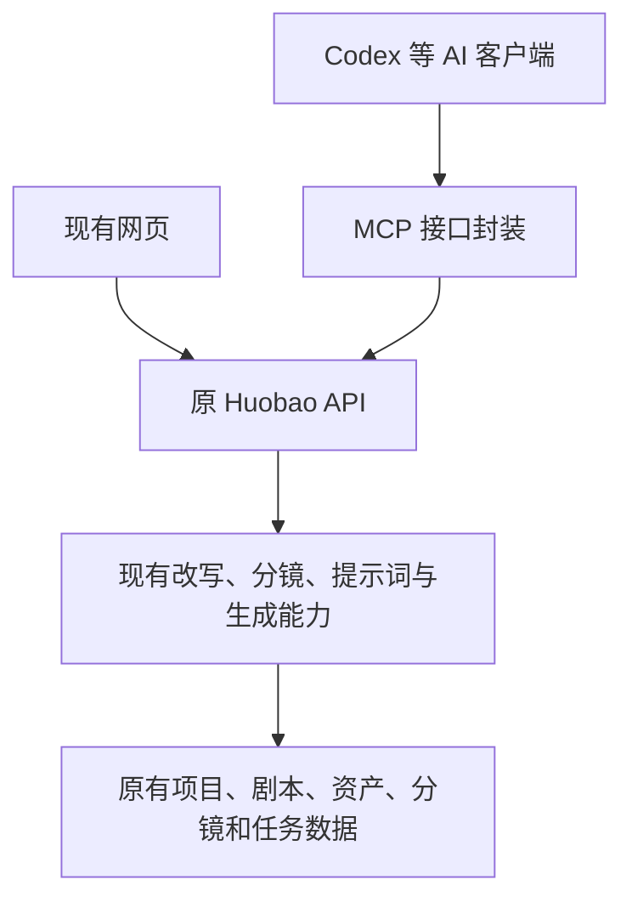

# Huobao 剧本与视频制作优化方案

调研日期：2026-10-04。依据：官方制作指南、模型 API 文档、当前仓库代码及运行中的提示词配置。本次只做调研和方案，不修改业务代码、不启动生成。

**本次改造聚焦强化 Huobao 已有的剧本改写和分镜提示词生成。** 保留现在的剧本、资产、分镜、视频和合成步骤，在每一步内部补足专业规则、上下文和结果检查，让问题尽早暴露，并且能只重做出问题的部分。

你的分工可以保持：提供原文和方向，审核剧本、样片、成片；AI 通过 MCP 操作已有能力。前端与 MCP 都承接同一套 Huobao 功能和数据，不另建制作服务、独立流程引擎、专属草稿库或第二套制作入口。原服务端源码不改的约束继续有效；可配置规则和需要改源码的限制分别列明。

## 1. 调研结论：专业程度来自哪些环节

| 关注点 | 官方资料中的做法 | 对本项目的建议 |
| --- | --- | --- |
| 剧本改编 | 剧本需要明确场景、可见动作与对白，经过修订；分镜再处理信息、构图和镜头安排。[Adobe 剧本](https://www.adobe.com/in/creativecloud/video/discover/video-script.html)、[分镜](https://www.adobe.com/creativecloud/video/discover/storyboarding.html) | 原文先变成故事提纲，再写剧本，最后设计镜头。分开检查“故事讲清了吗”和“拍得出来吗”。 |
| 前后衔接 | 连续性包括视线、空间方向、人物动作和道具状态。[Adobe 连续性剪辑](https://www.adobe.com/creativecloud/video/hub/ideas/what-is-continuity-editing-in-film.html) | 每镜记录开始与结束状态；下一镜必须接得上。只保持人物长相一致还不够。 |
| 图与提示词的分工 | Runway 图生视频指南让输入图确定构图、人物、光线和风格，文字主要描述运动；建议从关键动作开始逐步调整。[Runway Gen-4.5 指南](https://help.runwayml.com/hc/en-us/articles/48324313115155-Image-to-Video-Prompting-Guide) | 先确认关键帧，再让它动起来。详细的内部镜头设计，不必全部塞进最终视频提示词。 |
| 不同模型的写法 | Wan 3 支持多镜头和多种参考输入；Veo 的时长、首尾帧和参考模式有自己的限制。[Wan 指南](https://help.aliyun.com/zh/model-studio/wan3-video-generation-prompt-guide)、[Veo API](https://ai.google.dev/gemini-api/docs/veo) | 保存一份统一镜头设计，再按具体模型和输入模式转换。不能用一个模板覆盖所有模型。 |
| 流程与检查 | 明确任务适合分阶段执行、逐步检查；视频评估需要拆开看主体一致性、运动、闪烁等维度。[Anthropic 工作流](https://www.anthropic.com/engineering/building-effective-agents)、[VBench 论文](https://openaccess.thecvf.com/content/CVPR2024/html/Huang_VBench_Comprehensive_Benchmark_Suite_for_Video_Generative_Models_CVPR_2024_paper.html) | 每一步有明确产物和通过条件。失败后修对应环节，而不是重新生成整集。 |

这些资料支持的是制作方法和接口能力，不能证明某套方法能达到固定成品率。下面的改进建议结合了 Huobao 的实际问题，需要用样片验证。

## 2. 当前 Huobao 的主要问题

当前并非完全没有专业规则：已有节拍识别、台词估时、景别和参考素材字段。问题是这些规则比较粗，部分互相牵制，而且缺少执行后的验证。

| 已核实的实现 | 为什么容易出问题 | 改动方向 |
| --- | --- | --- |
| 改写主要是“读原文 → 格式化改写 → 直接保存”，还规定每场 30–60 秒 | 一分钟短片也套长场景规则；没有先检查动机、因果、信息取舍 | 在原改写操作内先规划、再写作、自查后保存到原剧本；用户在原页面审核 |
| 分镜按整个剧本文字数 ÷ 500 字/分钟估算总时长 | 动作、环境、制作说明也被当成片长依据 | 以目标片长为预算，按实际配音与表演安排时间 |
| 默认每段 8–15 秒、含 2–4 个子镜头；视频提示又固定按 3 秒分段 | 叙事和对白被格式牵着走；复杂段落难以单独修复 | 先设计剪辑镜头，再决定一次生成承载几个镜头 |
| 规则分散在提示词、Skill、前端指令和服务端批量生成逻辑 | 只改一份提示词，旧规则仍可能重新进入上下文 | 整理原有规则来源，更新可配置部分；写死在服务端的冲突单独列为限制 |
| 画面描述、氛围、音乐等字段没有全部直接进入视频请求；服务端另加项目风格词 | 网页填得很细，最终提交内容仍可能缺失或矛盾 | 显示并保存“项目风格 + 本镜提示 + 素材 + 参数”的提交快照 |
| 网页和 MCP 生成路径都固定开启视频原生音频；Wan 适配器默认开启提示词改写 | 逐字台词和已审核提示存在再次变化的环节 | 分离旁白；明确音轨与提示词改写开关 |
| 网页允许无参考图生成；MCP 又要求所有绑定资产都有图 | 一端容易丢失视觉一致性，另一端会挡住纯旁白等合理场景 | 按本镜真正可见的主体、输入模式检查素材 |
| 任务完成后会直接回写分镜视频；现有合成主要是拼接 | 文件生成成功，不代表台词正确、动作合理或可以采用 | 在现有结果预览中检查质量并局部重做；候选隔离和精细剪辑作为后续能力缺口列出 |

证据入口：[剧本模板](/Users/mubaili/Documents/Code/huobao-drama/backend/workspace/prompts/script_rewriter.md:8)、[分镜规范](/Users/mubaili/Documents/Code/huobao-drama/backend/workspace/skills/storyboard-breaker/SKILL.md:10)、[视频提示规范](/Users/mubaili/Documents/Code/huobao-drama/backend/workspace/skills/prompt-generator/video-prompt/SKILL.md:26)、[网页生成请求](/Users/mubaili/Documents/Code/huobao-drama/frontend/app/views/drama/episode.vue:3254)、[风格注入](/Users/mubaili/Documents/Code/huobao-drama/backend/src/routes/tasks.ts:154)、[Wan 参数](/Users/mubaili/Documents/Code/huobao-drama/backend/src/services/adapters/aliyun-wan-video.ts:130)、[完成回写](/Users/mubaili/Documents/Code/huobao-drama/backend/src/services/generation.ts:461)、[现有合成](/Users/mubaili/Documents/Code/huobao-drama/backend/src/services/ffmpeg-merge.ts:105)。

## 3. 如何强化现有制作步骤

**沿用现有步骤：原文与剧本 → 资产、分镜 → 视频制作 → 合成。** 下文的提纲、自查、镜头设计要素是各步骤内部的工作方法，不新增一套页面流程或任务状态。独立配音、预演等尚未具备的能力单列为后续增强，不作为第一期改造前提。

### 3.1 剧本：先解决故事，再增加细节

输入时只需明确：原文范围、片长、观众、类型与风格、允许多大程度改编、预算。不确定的项目可以用默认值，但不能擅自改变核心设定。

| 步骤 | 输出什么 | 检查什么 |
| --- | --- | --- |
| 读懂原文 | 人物关系、事件顺序、世界规则、必须保留的事实，并标记原文位置 | 是否误读原文，是否把未知信息编成确定事实 |
| 做改编提纲 | 每场要传达的信息、冲突或异常、结果变化；注明删减与增写 | 为什么发生、为何接下一场、结尾是否有前面的铺垫 |
| 写表演稿 | 可见动作、准确台词、必要旁白、停顿与反应 | 心理活动是否变成观众能理解的表现，是否有无效对白 |
| 做编辑审查 | 具体问题和局部修改稿 | 角色动机、因果、信息重复、时长、制作难度 |

“细节”要有作用。例如，角色停在门口反复确认门锁，既能表达恐惧，也能为后面的开门铺垫；堆砌墙面纹理则不一定改善故事。

不要给所有内容套同一种结构。档案怪谈适合“规则—证据—异常—余味”，人物短剧更需要“目标—阻碍—选择—后果”。长篇小说则按章节建立事件索引和角色状态，每集读取相关片段及前情，避免一次压缩整本书后遗漏关键设定。

**改写后仍在现有剧本页审核，确认后再拆分分镜。** AI 在原改写操作内完成规划、写作和自查；不另建草稿发布流程。现有保存工具会直接更新剧本，因此自查是生成要求，不等于程序已经具备审核锁或版本隔离。

### 3.2 镜头：每一镜都有任务和衔接

把下面的镜头设计要素加入现有分镜生成规范，结果仍保存在 `description`、`shot_type`、`angle`、`movement`、`atmosphere`、`result`、`duration`、`image_prompt`、`video_prompt` 等原字段中。视频提示必须依据同一分镜描述，避免各写各的；不为这些要素另建一套镜头数据。

| 要素 | 应当写清楚的内容 |
| --- | --- |
| 叙事任务 | 观众通过这一镜新增知道什么；为什么在这里切镜 |
| 动作与衔接 | 开始状态 → 主要动作 → 结束状态；接前镜的哪一步 |
| 空间关系 | 人物站位、朝向、视线、持物手、出入画方向、主光位置 |
| 摄影 | 景别、角度、机位、运镜及其目的；不需要移动时就固定 |
| 色彩与光线 | 主色、饱和度、明暗关系、光源方向与软硬；异常时哪些发生变化 |
| 材质 | 与画面有关的可见表现，例如湿地反光、旧塑料泛黄、布料受力褶皱 |
| 声音与时间 | 台词原文、说话人、音频版本、实际长度、停顿、剪辑入出点 |
| 制作输入 | 角色/场景/关键帧版本、生成模式、模型参数、验收重点 |

焦距感、光线方向、纹理描述可以帮助表达意图，但自然语言里的“35mm、粗糙度 0.6”通常不是精确的渲染控制。真正的接口参数和画面目标应分开保存。专业程度应体现在构图、光影和动作是否成立，而不是参数数量。

一次生成几个镜头，由内容难度和模型能力决定。简单连续动作可以合并；多人互动、精确道具交接、异常形变等高风险内容先拆小。剪辑切镜也不等于必须切断一条完整旁白。

一个异常投影镜头的写法示例（仅说明格式）：

> **本镜目的：** 让观众看清轮廓发生变化，而不是整块影子平移。
>
> **关键帧：** 固定监控机位，墙面占画面右侧；顶灯、人物和正常投影关系清楚。灰绿色低饱和，顶灯硬光，墙面哑光起皮，旧录像轻微拖影。
>
> **视频动作提示：** 固定机位连续拍摄。开始时保持参考图状态；随后墙上影子的肩部轮廓缓慢向外鼓起，形成不对称尖角，底部位置保持固定；最后停留，让变化可辨。人物与顶灯全程静止。
>
> **独立旁白原文：** “灯没有动，墙上的轮廓却改变了。”
>
> **接口参数：** 8 秒、16:9、720p、首帧模式、关闭原生音轨；按适用模式关闭智能改写。

例子的视觉细节主要由关键帧承担，视频提示集中描述变化。具体异常表现须由剧本决定，时间分配要经过配音和样片验证。

### 3.3 声音：先改准确台词，后补独立配音

第一期先在现有分镜和视频提示中写明逐字台词、说话人、发声顺序和停顿，保留完整语句，并在原视频预览中检查漏字、乱码和末句截断。这能改善输入，但不能保证视频模型准确发声。

独立配音和带声音的静帧预演是后续增强项。对 SCP 这类旁白主导的内容，具备对应能力后采用：

1. 固定旁白原文，先生成独立配音并试听，测量实际长度。
2. 按音频安排动作、停顿和切镜，用分镜静帧拼成带声音的预演片。
3. 调整到目标时长后，再生成运动画面。旁白、环境声、音效、音乐分别留轨。

字数只能用于初估。最终时间线以音频和动作实际需要为准；念不完就改写、删减或重排，不能直接截断末尾。

人物正面对白另外处理：先试原生音画生成，或单独制作口型同步，并检查台词、说话人和嘴型。独立配音本身不会自动解决口型。

Wan 允许关闭生成音轨，但不会因此降低同档视频价格；已审核提示在允许的输入模式下可关闭 `prompt_extend` 做对照，文件/网页输入则要求开启。应记录这个开关，不能假定厂商内部改写结果可见。[Wan API](https://help.aliyun.com/zh/model-studio/wan3-video-generation-api-reference)

### 3.4 用样片确认制作路线，再批量执行

在现有视频制作页先生成 2–3 个代表镜头：一个建立风格，一个考验关键动作，必要时再加一个对白镜头。看过结果再批量生成；具备预演能力后可增加预演检查，不新增“样片工作台”。

以影子异常为例，镜头设计应先明确：光源是否固定、主体是否移动、正常投影范围在哪里、异常究竟是位移还是轮廓变化。再把“按物理规律应保持不变的部分”和“剧情刻意发生的异常”分开，不能笼统要求“影子诡异地动起来”。具体变化仍须符合已审核剧本。

通过后用现有批量能力执行。失败按类别返工：视觉问题改参考图或动作提示；衔接问题调整前后镜；叙事问题回到剧本；台词问题先核对文本，具备独立音轨后再单独重做声音。AI 经 MCP 操作时，建议每镜最多修订重试 2 次，并遵守用户的费用上限；这属于调用约束，不引入新的制作引擎。

最终在现有合成结果中连播检查，再交用户审核。不能只看每段单独播放是否漂亮。

## 4. 在现有 Huobao 上如何开发

### 4.1 强化已有能力，保持现有调用关系

网页继续调用原服务端，MCP 补齐对这些接口的封装。剧本、分镜、资产和生成任务都以原服务端数据为准，网页不改成依赖 MCP 扩展才能制作。

| 位置 | 本次改什么 |
| --- | --- |
| 现有 Agent 提示词、Skill、风格配置 | 强化原文理解、叙事因果、镜头衔接、摄影、材质、声音和自查规范；两端调用同一 Agent 时使用同一配置 |
| 现有前端 | 在原改写、分镜、视频制作页面补充必要输入、参数说明和结果检查；保留原操作步骤 |
| MCP 扩展 | 补齐现有业务接口，传递与网页一致的制作要求；提供查询、批量和自动调用便利，不再实现一份独立改写或分镜业务 |
| 原服务端源码 | 本期保持不动；已有接口和数据结构继续使用，无法配置解决的问题如实列出 |

原服务端已经有 `POST /agent/:type/chat`，支持 `script_rewriter`、`storyboard_breaker`、`prompt_generator` 等 Agent。网页已使用这些接口，MCP 应补上对应调用，而不是默认让客户端自行改写后只把结果写回。用户明确要求由 Codex 直接编辑时，仍可使用现有写入工具。[现有 Agent 路由](/Users/mubaili/Documents/Code/huobao-drama/backend/src/routes/agent.ts)、[网页调用](/Users/mubaili/Documents/Code/huobao-drama/frontend/app/composables/useAgent.ts)

能力覆盖要求保持不变：**MCP 的业务能力不少于网页，网页独立保留核心制作能力。** 按现有功能逐项盘点接口，补齐 MCP 缺口；两端操作相同对象、读取相同结果。页面布局不需要照搬成工具，MCP 可以额外组合批量调用。

现有 MCP 计划、运行、去重和复核机制可继续用于自动调用，但不升级为网页必须接入的第二套制作系统。MCP 开关维持入口边界：关闭后原网页仍正常使用；暂停 MCP 自己的后续派发，不等于暂停原服务端已接收的任务。本次不为“共享流程”重构开关。[当前 MCP 工具](/Users/mubaili/Documents/Code/huobao-drama/extensions/huobao-mcp/src/tools.ts)

### 4.2 按问题分三步实施

| 阶段 | 开发内容 | 可验收结果 |
| --- | --- | --- |
| **第一步：强化剧本与分镜生成** | 更新原有 Agent 提示词和 Skill；在原操作中传入目标时长、内容类型、风格和必须保留的内容；补齐因果、连续性、镜头与声音规范；清理前端重复指令；MCP 封装对应 Agent 调用 | 从原页面或 MCP 发起，都使用相同生成能力和规则；剧本、分镜保存在原位置；用固定案例检查质量提升 |
| **第二步：强化视频输入与检查** | 在现有视频制作操作中补齐可用参数、实际提示预览、素材校验、模型差异说明和单镜重做；补齐 MCP 对前端业务的剩余覆盖 | 两端提交相同要求时参数含义一致；生成前知道真正提交的提示和素材；能定位到具体问题镜头 |
| **第三步：按验证结果补声音与剪辑能力** | 根据样片确定是否需要独立配音、试听测时、字幕和精细裁切；在原视频/合成步骤中补能力，并同时提供 MCP 访问 | 改善台词准确性与成片衔接；仍在原制作路径完成，不能成为 MCP 专属功能 |

第一期重点是前两项痛点，不以搭建新服务、草稿发布系统或流程引擎为开工前提。第三步涉及原系统尚未提供的能力，需要另列具体接口和源码改动范围，不能算成“换一份提示词”就能交付。

每一步先用当前 54–60 秒短片做小样。保留原文和旧输出作比较；不因配置更新自动重新改写、拆分或生成已有项目。

### 4.3 不改原服务端源码的实施边界

**配置可以改，硬编码不能假装消失。** 现有 `/prompts`、`/skills`、`/style-presets` API 可以更新生成规范；实施前备份有效配置并标明作用范围，部分配置会影响所有项目。前端请求中的旧指令也可以修改。但服务端批量提示生成仍写有“按 3 秒分段”，改写工具返回内容仍含“每场 30–60 秒”等要求。必须逐条判断能否由有效配置覆盖并实测；不能承诺所有入口只靠配置即可彻底统一。[批量提示生成](/Users/mubaili/Documents/Code/huobao-drama/backend/src/services/video-prompts.ts)、[改写工具](/Users/mubaili/Documents/Code/huobao-drama/backend/src/agents/tools/script-tools.ts)

若某项改进确实需要改服务端源码，列出最小修改点及不改的影响，另行确认范围；本期不擅自修改，也不绕到扩展中重写整套业务。

**现有数据没有新增的审核隔离。** 原 Agent 会直接写剧本或分镜，生成视频会自动回写当前视频。第一期沿用原页面检查与局部编辑，不宣称已有“未审核草稿不覆盖正式内容”的保证。版本、候选隔离若后续确有需要，应作为原能力的单独增强设计。

**声音和合成存在明确缺口。** 当前合成主要是拼接；独立配音、音轨检查和精细剪辑不是已实现能力。原视频上传上限为 50 MB，集更新接口也不支持任意写入 `video_url`。第三步必须围绕这些限制评估，不能依靠扩展私有成片库或另一套导出流程绕过原系统。[上传限制](/Users/mubaili/Documents/Code/huobao-drama/backend/src/routes/upload.ts:25)、[集更新字段](/Users/mubaili/Documents/Code/huobao-drama/backend/src/routes/episodes.ts:55)

**MCP 调用要遵守现有副作用。** Agent 接口可能写入内容甚至重建分镜，封装时需明确影响范围、保存调用回执，超时后先核对原数据，不盲目重发。接口封装不增加新的剧情生成规则，也不把模型自查当成人工批准。

## 5. 如何判断改造有效

先建立 8 个固定测试片段，覆盖档案旁白、双人对白、情绪反应、动作、道具交接、空间切换、跨镜连续动作和异常现象。改造前后使用相同原文、模型档位和费用上限，保留所有测试输出，而不是只展示最好的一次。

| 检查层 | 通过条件 |
| --- | --- |
| 剧本 | 核心设定有原文依据；增写可追溯；没有明显动机、因果、铺垫缺口；用户认可表达 |
| 分镜 | 剧情信息完整，空间与动作接得上；时长估计有依据，实测项与估计项明确区分；生成后检查真实片长 |
| 单段视频 | 主体和风格符合参考；关键动作发生；没有妨碍理解的变形、闪烁或突变 |
| 声音 | 台词、说话人与批准版本一致；末字完整；无异常人声；有对白时检查口型 |
| 成片 | 连播时节奏、画面与声音衔接成立；字幕可读；片长符合约定；用户最终通过 |
| 能力覆盖 | 前端业务操作都有 MCP 对应能力；网页可独立完成核心制作闭环；两端调用同一业务规则 |
| 跨入口接手 | MCP 调用原改写接口 → 网页查看并修改原剧本 → MCP 调用原分镜接口 → 网页查看分镜，全程操作同一剧集数据；反向接手同样通过 |
| 状态与开关 | MCP 和网页读取同一生成任务结果；关闭或停止 MCP 扩展后，原网页仍能独立使用；不新增第二套制作状态 |

第一期检查输出字段、素材引用、台词、时长预算及实际结果，人工判断故事、表演和情绪。后续若引入语音转写与画面分析，用它们帮助定位问题；它们也会误判，不能以一个总分代替用户批准。

重点记录四项：**首次提交后可采用的镜头比例、每分钟可用成片的生成费用、每镜重试次数、每分钟成片的人工修改时间。** 先测当前基线，再设置改善目标，不预先承诺“成品率 90%”。

优先从当前 SCP 短片验证“准确旁白 + 固定风格 + 可辨认的异常动作 + 完整剪辑”这条最小流程。它通过后，再扩大到对白短剧和更长内容。
