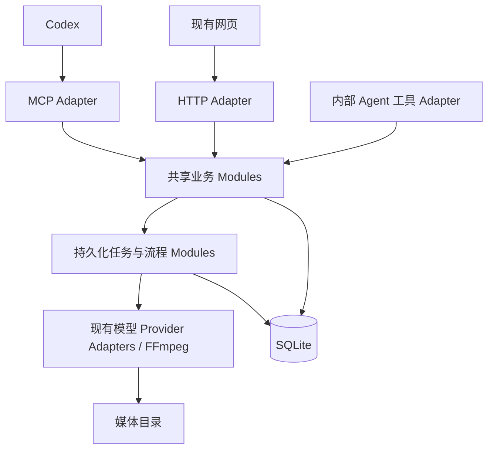

# 火宝 MCP 与制作流程托管改造方案 v1（历史提案）

状态：历史设计提案，尚未实现；当前方案为 [独立扩展 v3](./mcp-service-design.md)。日期：2026-10-04。

保留用途：原网页能力映射、代码调查和底层可靠性设计参考。工具清单、工具数量及实施阶段不再作为当前实施依据；冲突时以 v3 为准。

## 1. 目标与交付边界

目标工作方式：用户给出创作要求并负责质量验收；Codex 理解要求、调用工具、落实反馈；火宝负责制作规则、模型调用、任务执行、文件存储和流程状态。

必须满足：

1. Codex 可以通过 MCP 完成项目创建到成片导出的核心制作闭环，并支持单项修改、局部重做。
2. 网页、MCP、火宝内部 Agent 操作同一份数据。MCP 操作提交成功后，页面主动刷新能够看到结果；异步操作能够看到任务及其后续产物。
3. Codex 断开不终止已经提交的制作任务。后端重启后，可查询的上游任务恢复查询，结果不明的提交不能盲目重发。
4. 长流程运行到指定验收节点停止；用户的通过、退回与具体内容版本绑定。
5. 保留当前界面和已有制作能力，通过共享业务实现逐步改造。

第一阶段交付核心制作闭环和刷新同步；第二阶段交付可靠的批量执行与恢复；第三阶段交付整集工作流与验收续跑。管理配置和桌面专属能力单独收尾，不能把第一阶段称为“所有功能已经覆盖”。

初始部署假设：单用户、单个火宝后端进程、SQLite 与媒体目录位于同一主机。先支持当前开发/服务器模式，再适配 Electron 动态端口。多租户、分布式 worker、实时协同编辑不在本次范围。

## 2. 代码现状与需要改造的原因

| 现有位置 | 已具备能力 | 影响设计的事实 |
| --- | --- | --- |
| `backend/src/index.ts` | Hono `/api/v1`、静态资源、服务启动 | 暂无 MCP 入口；启动时把所有 processing 的 sys_task 标记为 failed |
| `routes/dramas.ts`、`episodes.ts` | 项目、剧集、剧本、资产与分镜查询 | 剧集详情依附项目详情返回；需补小粒度查询与一致的删除过滤 |
| `routes/agent.ts` | 四类 Mastra Agent 执行 | 同步等待 generate 完成，没有统一持久化任务 ID |
| `services/extraction.ts`、`video-prompts.ts` | 后台资产提取、批量提示词 | 任务状态在 Map 中，重启丢失 |
| `services/generation.ts` | sys_task、厂商适配、轮询、下载、业务回写 | 创建后直接启动内存执行；完成记录与业务回写分开；旧任务可能覆盖新选择 |
| `services/ffmpeg-merge.ts` | FFmpeg 合成及 video_merges | 默认跳过没有视频的镜头，不能把“合成成功”直接等同于“完整成片” |
| `frontend/app/views/drama/episode.vue` | 完整工作台 | 批量视频/场景/道具任务发起、参考素材排序、@名字替换还在前端 |
| `agents/tools/storyboard-tools.ts` | 分批保存分镜 | replace_existing 会先删除旧分镜；Agent 中断可能留下部分结果 |
| `routes/aiConfigs.ts` | 模型配置查询与修改 | 当前读取会返回 api_key，不适合作为 MCP 模型发现结果 |
| `desktop/src/main.ts`、`preload.ts` | 桌面后端启动、迁移、更新 | 动态后端端口；迁移、桌面更新经 IPC，不属于已有 HTTP 接口 |

网页已有 `refresh()`：读取项目中的剧集、剧集资产、分镜、任务和合成记录。共享数据库是刷新同步的基础，但还需统一数据提交、缓存策略和编辑冲突处理。

## 3. 架构决策



### 3.1 共享实现的位置

使用 codebase-design 的 Module / Interface / Seam / Adapter 概念：业务 Module 的 Interface 是复用 Seam，HTTP、MCP 和内部 Agent 工具都是调用它的 Adapter。参数校验、归属检查、关联更新、幂等提交、版本检查放在共享 Module 内。

建议目录（均为拟新增）：

```text
backend/src/
  app.ts                       # 组装 Hono，不监听端口、不启动 worker
  index.ts                     # 启动、恢复、监听、关闭
  contracts/                   # Zod 输入输出、业务错误、公开 DTO
  application/
    projects.ts                # 项目和剧集读写
    scripts.ts                 # 原文/剧本读写与改写任务
    assets.ts                  # 角色/场景/道具、关联与图片任务
    storyboards.ts             # 分镜读写、绑定、重排和草稿提交
    production.ts              # 素材解析、生成参数准备、生产前检查
    media.ts                   # 上传产物、历史版本、选用与预览
    exports.ts                 # 完整性检查、合成任务与历史
    configuration.ts           # 脱敏能力发现与管理
  jobs/
    repository.ts              # 任务、尝试、租约的原子操作
    runner.ts                  # 有界并发、调度、恢复
    handlers/                  # Agent / 图像 / 视频 / 合成
  workflows/                   # 后续阶段：模板、执行、审核、失效判断
  mcp/
    server.ts                  # SDK 初始化、注册、生命周期
    http.ts                    # Streamable HTTP 接入
    tools/                     # 按业务分组注册
    resources.ts               # 可选的只读资源
    errors.ts                  # 业务错误映射
```

不另建一套生成和落库逻辑，也不让 MCP 直接操作 SQLite。已有 Provider Adapters、风格逻辑、FFmpeg 和存储工具继续复用。简单 CRUD 可先迁移到共享 Module，复杂 Agent 工具逐项接入。

### 3.2 接入方式

- 主方案：现有后端提供 `/mcp` Streamable HTTP 入口，挂在静态网页兜底路由之前。所有任务归同一个后端管理。
- SDK 使用官方 TypeScript SDK；实施阶段先做 Hono、当前 Node/Electron 和客户端协议协商验证，再锁定依赖版本。不要混用 v1/v2 示例中的包名和入口。
- 核心能力仅依赖普通工具调用：提交返回 `job_id`，再查询。MCP Tasks 扩展、资源订阅不是流程正确性的前提。
- 本地可选 stdio 桥接：仅连接现有 MCP 后端；不导入数据库初始化、不启动第二个业务后端、不拥有 worker。stdout 只输出协议，日志走 stderr。
- 桌面进程启动后在 userData 原子写入受限权限的连接信息：`instance_id`、`url`、PID 和启动时间。桥接先检查健康状态与实例标识；退出清理，崩溃残留不可直接信任。桌面重启后重新发现地址。
- 开发、桌面开发版、桌面正式版可能对应不同数据库。`hb_get_capabilities` 返回稳定的 `workspace_id` 和当前 `instance_id`，界面设置页也显示，便于确认连接的是同一实例。

MCP 官方工具规范定义了输入输出 schema、structuredContent 和工具错误；HTTP 传输和 SDK 的版本协商由官方实现承担。本设计不手写协议层。[工具规范](https://modelcontextprotocol.io/specification/2026-07-28/server/tools)、[HTTP 传输](https://modelcontextprotocol.io/specification/2026-07-28/basic/transports/streamable-http)、[SDK 版本兼容](https://ts.sdk.modelcontextprotocol.io/v2/migration/support-2026-07-28)。

## 4. 对外工具设计

### 4.1 统一约定

- 工具命名采用 `hb_动词_对象`。业务字段统一 snake_case；历史 HTTP 返回通过 Adapter 兼容，不要求一次性全站改名。
- 数字 ID 使用现有业务 ID；新增 job/run/artifact/draft ID 使用带类型前缀的 UUID。不通过当前对话隐式确定项目或剧集。
- 写工具只接受明确字段，拒绝未知键。资源必须存在、未删除，且属于指定项目/剧集；不能仅验证 ID 是数字。
- `list` 支持游标分页，默认 20、最大 100；批量变更一次最多 100 项，较大制作批次由后端计划分组。
- 业务返回使用 `structuredContent`，并提供一致的文本 JSON 回退。工具声明 output schema。
- 查询只返回摘要；大段剧本、完整分镜、历史按需读取。媒体返回 artifact ID、MIME、预览 URL，不把整个视频或所有图片 base64 塞进上下文。
- 所有创建、删除、生成、选用、流程推进操作接受并要求 `request_id`。编辑和选用要求 `expected_revision`；系统内部流程步骤使用稳定的派生 request_id。
- 工具注解声明只读、破坏性、幂等语义等，但注解不代替服务端校验或实际幂等逻辑。

### 4.2 工具清单与分阶段覆盖

表中的组合写法代表多个独立工具；确有相同数据结构的三类资产通过 `kind` 区分，并使用明确的判别联合 schema。禁止提供任意 SQL、任意 HTTP 转发或任意路径写入的万能工具。

| 分组 | 拟提供工具 | 内容与阶段 |
| --- | --- | --- |
| 能力发现 | `hb_get_capabilities`、`hb_list_models` | 实例标识、启用工具、模型配置 ID、能力和限制；P1 |
| 项目 | `hb_list_projects`、`hb_get_project`、`hb_create_project`、`hb_update_project`、`hb_delete_project` | 元数据、风格、比例及软删除；P1 |
| 剧集 | `hb_list_episodes`、`hb_get_episode`、`hb_create_episode`、`hb_update_episode`、`hb_delete_episode` | 摘要、原文、剧本、分辨率；创建仍遵循现有模型配置要求；P1 |
| 剧本 | `hb_get_script`、`hb_save_script`、`hb_rewrite_script` | 直接保存 Codex 创作结果，或委派内部 Agent；P1 |
| 资产 | `hb_list_assets`、`hb_get_asset`、`hb_create_asset`、`hb_update_asset`、`hb_delete_asset`、`hb_link_assets`、`hb_unlink_assets` | kind=character/scene/prop；关联复用与完整 CRUD；P1 |
| 资产生产 | `hb_extract_assets`、`hb_generate_asset_prompt`、`hb_generate_asset_image` | 返回 job_id，提取支持指定类型；P1；可靠批量 P2 |
| 分镜 | `hb_list_storyboards`、`hb_get_storyboard`、`hb_create_storyboard`、`hb_update_storyboard`、`hb_delete_storyboard`、`hb_reorder_storyboards`、`hb_breakdown_episode` | 包含人物/场景/道具绑定；整集拆分先产草稿；P1 |
| 分镜生产 | `hb_generate_video_prompts`、`hb_prepare_video`、`hb_generate_video`、`hb_generate_storyboard_image` | 提示词、生成前检查、视频及已有首尾帧/分镜图能力；P1 |
| 草稿 | `hb_get_draft`、`hb_commit_draft`、`hb_discard_draft` | Agent 批次写入草稿，完整校验后替换正式内容；P1 |
| 媒体 | `hb_list_artifacts`、`hb_get_artifact`、`hb_select_artifact`、`hb_hide_artifact` | 图片、视频、上传与导出版本；选用和历史隐藏；P1 |
| 文件输入 | `hb_create_upload`、`hb_complete_upload` | 上传凭据/地址及落库完成；文件正文通过上传通道传输；P1 |
| 导出 | `hb_export_episode`、`hb_list_exports` | 全集或指定镜头合成、产物查询；P1 |
| 任务 | `hb_get_job`、`hb_list_jobs`、`hb_get_job_events` | 进展、子任务、错误、产物与变更目标；P1 |
| 批量与控制 | `hb_generate_batch`、`hb_retry_job`、`hb_cancel_job` | 受控并发、选择性重试、真实取消语义；P2 |
| 工作流 | `hb_plan_workflow`、`hb_start_workflow`、`hb_get_workflow`、`hb_pause_workflow`、`hb_resume_workflow`、`hb_cancel_workflow` | 固定制作模板、检查点、执行与恢复；P3 |
| 验收 | `hb_list_reviews`、`hb_get_review`、`hb_submit_review` | 精确版本、意见、通过或退回；用户主动调用模式，见第 8 节；P3 |
| 配置管理 | `hb_manage_model_config`、`hb_test_model_config`、`hb_manage_style_preset`、`hb_manage_prompt`、`hb_manage_skill`、`hb_manage_settings` | 按操作判别输入，读取始终脱敏；独立管理工具组 P4 |
| 运行维护 | `hb_get_storage_info`、`hb_check_update`、`hb_apply_update` | 存储统计及服务器更新；P4，更新前检查在途任务 |
| 桌面维护 | `hb_migrate_storage`、桌面更新工具 | 桌面进程 Adapter；需要重启和连接恢复；P4，可选启用 |

全量覆盖以业务动作验收，不以“每条旧路由机械对应一个工具”验收。统计、流水线摘要并入查询；删除旧任务记录对应隐藏历史，不能伪装为取消。首次使用引导、主题、侧栏尺寸等纯 UI 偏好不属于制作工具。

现有 `/agent/:type/chat` 保留兼容。MCP 默认暴露有明确结果类型的制作工具，不直接把一个自由文本 Agent 聊天工具当作全部能力。

默认注册 production 工具组，configuration 和 maintenance 按配置追加；能力查询返回已注册工具及版本。无需在一次调用里读取全部剧本和资产。Resources 可提供 `huobao://episodes/{id}/summary`、`huobao://jobs/{id}` 等只读视图，复用相同权限和 DTO；它们是便捷入口，工具查询仍可独立完成工作。内部 Agent 的 Prompt/Skill 编辑属于火宝配置，不等同于向 MCP 客户端注册同名 Prompts。

### 4.3 长任务输入输出示例

以下是业务 DTO，不是某个协议版本的完整 JSON-RPC 报文。

```json
{
  "tool": "hb_generate_video",
  "arguments": {
    "storyboard_id": 42,
    "expected_revision": 7,
    "request_id": "episode-3-shot-42-take-2",
    "selection_policy": "candidate_only"
  }
}
```

```json
{
  "job_id": "job_…",
  "status": "queued",
  "target": { "kind": "storyboard", "id": 42, "revision": 7 },
  "effective_config": { "config_id": 2, "model": "configured-model", "resolution": "720p" },
  "poll_after_ms": 3000,
  "ui_url": "http://localhost:5679/…"
}
```

`ui_url` 由现有 Nuxt 路由构造器生成，上述地址仅为占位，实施时验证真实路由。只在任务提交事务成功后返回 queued；不得先返回成功再异步创建记录。Agent、提示词补全、模型调用全部在后台任务内执行。

业务错误格式：`{ code, message, retryable, details, request_id }`，MCP 映射为工具执行错误；协议格式错误由 SDK 处理。主要 code：`NOT_FOUND`、`INVALID_BINDING`、`REVISION_CONFLICT`、`MODEL_NOT_CONFIGURED`、`MISSING_REFERENCE`、`IDEMPOTENCY_CONFLICT`、`SUBMISSION_UNKNOWN`、`REVIEW_REQUIRED`、`CANCEL_UNSUPPORTED`。details 给出缺失对象、当前版本或下一步，不返回密钥、完整模型请求头。

## 5. 视频生产 Module：把前端规则收进后端

`production.prepareVideo(storyboardId, overrides)` 必须承担：

1. 读取分镜、剧集、项目及其绑定资产，检查归属、删除状态和引用图片是否可读。
2. 解析生效模型：显式配置 > 剧集锁定配置 > 默认配置。显式指定的失效配置直接报错；隐式回退必须在结果中说明。恢复旧任务不能偷偷换厂商或模型。
3. 读取项目比例、剧集分辨率、分镜时长；根据 Provider 能力返回实际值和调整说明，不让 Codex 猜厂商参数。
4. 固定参考图顺序：场景、按保存顺序的角色、按保存顺序的道具；去重并建立名字到图片索引映射。
5. 复用并测试前端 @名字 转换规则。名字歧义、缺图、超出图片数量限制要返回明确检查结果，不能静默截断造成引用错位。
6. 注入视觉风格，规范首尾帧和多模态引用，生成参数快照及其 hash。
7. 返回 `effective_params`、引用摘要、warnings、输入版本清单及 `plan_hash`。不提交付费任务。

`generateVideo` 使用同一准备函数，不接受由客户端绕过校验的“已准备参数”。可携带 `expected_plan_hash`，准备结果有变化则要求重新读取。提交时把参数快照、配置 ID 和素材版本固定下来。

前端 `genVid()` 改为调用同一业务动作，不再维护参考图映射；原始 `/tasks` 能力保留给现有直接生成场景，但也必须经过共享提交逻辑。资产生图、提示词生成遵循同样原则。

## 6. 持久化任务与恢复

### 6.1 数据模型

复用现有 sys_task 和 video_merges 作为兼容记录，新建统一的业务任务账本。它们不是两套独立调度器。

| 表/字段 | 关键内容 | 引入阶段 |
| --- | --- | --- |
| 业务对象 `revision` | 项目、剧集、角色、场景、道具、分镜的编辑版本；默认 1 | P1 |
| `command_requests` | request_id、operation、scope、input_hash、result_json；scope+operation+request_id 唯一 | P1 |
| `production_jobs` | id、kind、drama_id、episode_id、target、input_snapshot、状态、输出、错误、source、lease、heartbeat、attempt、created_at | P1 |
| `job_attempts` | job_id、attempt_no、provider_request_key、provider_task_id、配置快照、提交/轮询阶段、重试信息 | P1 |
| `job_events` | 自增 seq、job_id、type、脱敏 payload、时间；游标分页 | P1 |
| `media_artifacts` | 目标、kind、存储键、MIME、hash、大小、来源 job、输入版本、候选/历史状态 | P1 |
| 业务对象媒体选择字段 | selected_artifact_id 按 image/video/frame 等槽位区分，selection_revision；同时维护旧 URL 字段 | P1 |
| `production_drafts` | kind、scope、base_revision、结构化内容、生成 job、提交状态 | P1 |
| `workflow_runs`、`workflow_steps` | 模板版本、目标阶段、输入版本、依赖、job_id、状态、策略 | P3 |
| `review_requests`、`review_decisions` | 待验收快照、版本清单、对象意见、决定、来源和时间 | P3 |

`sys_task`、`video_merges` 增加可空 `job_id`，新任务关联唯一 job；历史记录保持可读。production_jobs 有显式 episode_id，不再仅凭跨集共享角色反推归属。P3 为历史修改和审批引入 `entity_revisions` 快照表；P1 的 job/draft/artifact 已保留生产所需输入快照。

数据库至少建立以下约束和索引：command_requests 的复合唯一键；job_attempts(job_id, attempt_no) 唯一；job_events(job_id, seq)；production_jobs(status, next_run_at)、production_jobs(episode_id, created_at)；media_artifacts(target_kind, target_id, created_at)。分镜重排和关联集合替换在事务中执行，批量数据先整体校验再写入，避免处理到中间才发现非法引用。

### 6.2 执行权与状态

```text
queued → running → waiting_provider → finalizing → succeeded
             └──────────────────────────────────→ failed
             └→ needs_attention（提交结果不明或恢复受阻）
queued → cancelled
running/waiting_provider → cancel_requested → cancelled 或原任务最终结果
```

状态以 production_jobs 为准，写入时同步更新旧表的兼容状态；新页面显示精确状态。旧页面只能表示 processing/completed/failed，兼容映射必须附带 job_status，不能把 needs_attention 冒充成功。

- runner 是唯一执行者。提交只入队；移除被迁移路径里的 detached `processTask` 和内存 Map 执行入口。
- SQLite 原子认领：状态和租约条件更新，保存 owner、lease token、到期时间；完成写回也核对 lease token，过期 worker 不能覆盖新执行者。
- 不在 SQLite 事务中等待网络或 FFmpeg。短事务使用 better-sqlite3 支持的同步事务方式。
- runner 定时扫描 queued/到期查询任务；数据库提交后可发内存唤醒信号加速，但正确性不依赖信号不丢失。租约与 heartbeat 参数可配置；即使单进程，也要避免重复定时器同时认领同一任务。
- 默认每类并发作为配置提供，建议初值 text=2、image=2、video=2、merge=1；Provider 限流可以进一步压低。等待远端结果仍计入该 Provider 的在途配额。
- 重启只接管租约已失效的任务；新任务不能继续被旧启动逻辑一刀切标记为失败。
- 客户端关闭、MCP HTTP 超时只结束连接，不等于取消已持久化的生产任务。

### 6.3 幂等与未知提交结果

同一 request_id + 同一规范化输入返回同一结果/job_id；相同 request_id 配不同输入返回冲突。创建对象、command_requests 结果和任务入队在一个事务中提交。并发重复请求依赖唯一约束，而不是进程内 Map。

幂等输入 hash 包括调用者显式参数及预期版本；首次执行固定生效参数快照。同 key 重放先返回首次结果，不因默认模型后来变化产生新任务。记录保留至对应项目/任务明确清理，不设置几分钟过期导致重复收费。

| 恢复情形 | 处理 |
| --- | --- |
| queued，尚未调用 Provider | 可安全执行 |
| 已记录 provider_task_id | 用原配置继续查询，不重新生成 |
| Provider 支持幂等键 | 使用原 key 查询或重试提交，遵循厂商语义 |
| 请求可能已送达，但没有拿到 task_id | 标记 needs_attention / SUBMISSION_UNKNOWN，不自动重发 |
| 已拿到远端产物，下载失败 | 重试下载和入库，不再付费生成 |
| 同步返回图片/base64 后、尚未持久化即崩溃 | 若不能从 Provider 查询恢复，则标记结果不明，不能保证无损恢复 |
| FFmpeg 中断 | 清理该次临时产物，使用相同输入快照重跑 |
| Agent 生成草稿中断 | 草稿保留为未完成，不能把部分分镜当整集完成；重试产新草稿 |

不能承诺跨本地数据库与所有外部 Provider 的 exactly-once。可承诺本地重复命令只入队一次，并明确报告无法判定的外部提交。

P2 取消语义：未执行任务直接取消；已提交任务仅在 Provider Adapter 明确支持取消时调用。否则停止后续步骤、继续跟踪在途结果并保留候选，返回“上游无法取消”；不声称停止计费。暂停工作流同样只阻止新步骤。

## 7. 数据一致性、媒体选择与页面刷新

### 7.1 成功的定义

同步变更：业务写入、关联关系、revision 增长和命令结果原子提交后返回成功。

异步变更：提交成功仅表示 job 已落库；job succeeded 要等到主产物存在、artifact 已创建、必要关联及兼容 URL 回写完成。缩略图/海报失败可以作为 warning，不能让主产物在数据库缺失却显示成功。

文件先写任务专属临时路径，校验后原子重命名到最终不可变路径，再进行短数据库事务；崩溃留下的孤立文件按 job/artifact 标识回收。数据库引用文件的提交不能早于文件可用。

### 7.2 候选与当前采用版本

- 新媒体总是先成为 artifact。`selection_policy` 支持 `if_empty` 和 `candidate_only`，默认 if_empty；已有当前产物时，重生成不自动覆盖。
- if_empty 仍检查提交时的目标内容 revision 与媒体选择 revision。内容已被修改、用户已选其他版本、目标已删除时，只保留候选并报告未自动采用。
- `hb_select_artifact` 校验 artifact 归属、类型、可用性和 expected_revision，原子更新选择字段及旧 image_url/video_url 字段。
- 区分内容 revision 与媒体 selection_revision；任务进度、海报补全不应导致剧本内容冲突。产物依赖记录同时包含输入内容版本和选用媒体版本。
- Agent 工具写入也走同样的 revision 校验，不能绕过保护。模型配置、Prompt、Skill 记录版本/hash，任务保存当时使用的版本。

整集分镜替换从“先删后生成”改成“生成完整草稿后提交”。提交时核对剧集分镜集合版本，事务内应用差异：明确延续的镜头保留稳定 ID；新镜头新建；移除镜头软删除并保留历史产物关联。没有稳定映射的整集重新拆分不按镜号强行继承旧视频。Agent 的自然语言“完成”不能作为提交条件，必须通过草稿结构、引用和步骤输出校验。

视频实际时长记录在 artifact 元数据中，不让生成完成回调无条件覆盖用户刚编辑的分镜计划时长；需要采用实际时长时也经版本检查显式更新。

### 7.3 网页读取

P1 保留现有页面布局，但完成下列改动：

1. 新增 `GET /api/v1/episodes/:id/workspace`，在一个数据库读取快照中返回剧集、资产、分镜、选用产物及任务摘要；完整脚本可按需读取。P3 再加入工作流与验收状态。
2. `episode.vue` 的首次加载和主动刷新改用该快照；项目列表、详情也统一排除已删除内容。继续提供分页的任务/历史接口。
3. 动态业务读取使用 `Cache-Control: no-store`；媒体维持 UUID 不可变路径与长缓存。新版本生成新 URL，不能覆盖旧 URL 内容。
4. 任务界面显示 source=web/mcp/workflow/internal_agent，并给出失败项和候选产物；MCP 写入后刷新不依赖旧页面的本地 pending 数组。
5. 修正现有 `saveRaw()` / `saveScr()` 未等待请求即更新本地状态的行为。保存成功后才更新基线 revision，失败保留编辑内容。
6. 编辑器维护 base_revision 与 dirty 状态。普通数据刷新不覆盖未保存草稿，发现外部修改显示“服务端已有新版本”。保存冲突返回 409，并展示差异供选择；浏览器硬刷新前对未保存内容提示。
7. `frontend/app/composables/useAgent.ts` 从等待一次长 HTTP 请求改为提交 job、读取状态并在实际完成后刷新；不能收到 queued 就弹“完成”。草稿任务完成后展示预览/提交动作，提交后的正式内容才参与后续生产。同步旧 Agent 路由作为兼容等待 Adapter 也必须复用同一个 job，不能额外执行一次。

新 REST 查询：`/jobs`、`/jobs/:id`、`/jobs/:id/events`、`/artifacts`、`/drafts/:id`；相应写动作与 MCP 调同一 Interface。已有路由作为兼容 Adapter 保留，已迁移编辑入口必须传 revision，不能让旧网页无条件覆盖新内容。

P1 只承诺主动刷新同步。P2 可给运行任务定时刷新；P3 可增加变更事件通知。无论是否有推送，首次加载和刷新都以数据库快照为准。

## 8. 工作流与质量验收（P3）

### 8.1 固定模板先行

先提供 `episode_production_v1`，不做可视化任意 DAG 编辑器。步骤为：

```text
原文/现有剧本
  → 可选剧本改写 → 剧本验收
  → 提取资产 → 提示词/图片生成 → 资产验收
  → 分镜拆解/视频提示词 → 分镜验收
  → 视频生成 → 镜头验收
  → 完整合成 → 成片验收
```

现有资产可复用；没有道具是合法结果；直接提供格式化剧本可跳过改写。用户指定 `stop_after` 和启用的 review_points，默认在上述质量节点等待。达到 stop_after 表示本次请求范围完成，必须同时返回整集仍未完成的阶段。

`hb_plan_workflow` 只返回步骤、缺失输入、拟复用内容、模型、预估任务数量和总视频时长。没有可靠价格数据时，费用字段为 unknown，不虚构金额。计划保存 plan_id、plan_hash 和版本；启动时验证计划仍有效。

`hb_start_workflow(plan_id, expected_plan_hash, request_id)` 返回 run_id；步骤使用稳定 request_id 创建 job。每集初期只允许一个活跃的写工作流；共享资产更新会影响关联剧集，必须在影响清单中列出。

工作流状态：planned、running、awaiting_review、paused、needs_attention、failed、succeeded、cancelled。succeeded 必须满足请求范围内的步骤和验收，不由“已有一些文件”推导。

### 8.2 验收记录与用户操作

验收包包含正文/分镜/缩略图/视频预览、待验收 artifact ID、版本/hash 和汇总问题。可以逐项通过、退回并写意见。镜头质量仍由用户实际观看判断，海报或模型建议不能代替完整视频验收。

用户可以在网页验收，也可以明确告诉 Codex“通过哪些项、退回哪些项”，再由 `hb_submit_review` 代为记录；工具必须包含 review_id、expected_review_revision、decision、对象清单和意见。服务端验证精确快照，没有通过全部必需项就不能继续。

审核来源标记为 `web_user` 或 `mcp_delegated`。后者仅表示客户端转达，不声称服务器能够证明自然语言来自人类。需要强制人工验收时，启用 `review_mode=ui_only`，MCP 只能附加意见，只有网页会话能通过。默认个人使用为 delegated，保留当前希望通过 Codex 工作的体验；工具说明明确不得由模型自主宣称用户验收通过。

退回后保留原验收记录；修改产新版本并生成新验收包。`resume_workflow` 不能绕过未通过或已失效的审核。用户可在启动计划时明确减少检查点，减少重复打断。

### 8.3 上游修改与局部重做

依赖按生产输入快照判定，旧产物仍可预览，但标记 stale，不能自动视作当前版本合格。

| 修改 | 失效范围 |
| --- | --- |
| 剧本正文 | 对应资产提取/分镜计划与后续内容需要重新评估 |
| 角色描述或选用图片 | 使用该角色的相关镜头及其合成 |
| 单个分镜描述、提示词、绑定、时长 | 该镜头视频及使用它的合成 |
| 某镜头采用另一个视频版本 | 使用它的合成 |
| 项目画风/画幅、剧集生产分辨率 | 依赖这些参数的未确认生产步骤和产物 |
| 标题等展示信息 | 不使媒体失效 |

生成中的任务使用旧快照继续完成，只保留为候选，不能覆盖新版本。仅重跑受影响步骤；上游修改没有造成实际生产输入变化时，不为了 revision 变化盲目重新计费。

共享 Module 必须发出变更记录或在下一步调度前校验依赖 hash；调度不能只依赖内存事件，重启后也要重新检查。

### 8.4 合成的完整性

工作流导出默认 `require_all=true`：所有计划镜头必须有可用、当前、已通过验收的选用视频。缺失任何镜头返回缺失列表。用户主动选择部分镜头导出时显式使用 selection 和 `allow_partial=true`，结果标记 partial、列出跳过项，不作为整集完成。

## 9. 文件输入、媒体访问与配置

- 大文件走上传通道：MCP 创建有大小/MIME/有效期限制的 upload_id 与一次性地址；调用方通过 HTTP 上传二进制，再 complete 得到 artifact_id。完成操作幂等，上传与最终绑定分开。
- Codex 侧没有文件传输能力时，可以在网页上传后通过 artifact_id 复用；不假设所有 MCP 客户端能任意读取本机文件。
- 后续本地桥接可增加受配置目录约束的文件导入工具，通过真实路径检查后上传。远程后端不能把客户端本地路径当作服务端路径。
- 首版不提供任意 URL 导入；若后续增加，必须约束目标地址、重定向、大小和超时，并使用存储 Module 管理落盘。
- 数据库存相对存储键；对外 URL 按受信的应用访问基地址构造，不直接信任 Host 头。`APP_BASE_URL` 面向客户端预览，现有 `PUBLIC_BASE_URL` 仍用于供应商下载参考素材，两者用途分开。
- 本地 URL 只适用于能访问该主机的客户端；远程模式需提供可访问的媒体地址或限时下载凭据。缩略图可经有大小上限的媒体读取工具返回图片内容块。
- `hb_list_models` 只返回 ID、provider、model、支持类型/限制和启用状态。配置密钥采用写入不回显；日志、任务快照不存明文密钥，恢复用 config_id 查密钥并核对配置身份。
- 运行已有任务时配置被删除/禁用则标为需要处理；不得使用新默认厂商查询旧 task_id。
- 风格、Prompts、Skills 的管理限定为已登记类型和逻辑 ID，复用现有工作目录，不暴露任意文件路径。修改带 revision/hash，旧任务仍记录原版本。

## 10. 连接与访问控制

此处仅定义新增入口所需的最小机制，不扩展为多用户权限系统。

- 本地 MCP 默认仅监听 loopback，使用独立连接凭据；凭据由设置/启动配置提供，不在工具返回中展示。校验 Origin/Host，阻止非预期网页跨源访问；CORS 不是鉴权。
- 同源网页通过自己的应用会话调用 HTTP，不从页面脚本公开 MCP 凭据。新增远程模式时统一保护业务 API 和媒体，不能只保护 `/mcp` 却让原始写接口公开绕过。
- 远程发布依赖 TLS 和符合所选协议/客户端要求的身份认证；P1 验证本地模式，P4 再验证远程部署，不把公网无鉴权 HTTP 当默认方案。
- 工具按 production、configuration、maintenance 注册。制作组默认可用，管理组由实例设置开启，页面明确显示开放范围。批量生产可设任务数/时长上限；缺少价格数据时不伪装为精确费用预算。
- 源数据中的小说文本、Prompt、Skill 是内容；它们不能更改 MCP 权限或触发管理操作。操作记录包含 request_id、来源、目标和任务关联。

## 11. 渐进迁移与实施顺序

### P0：接入验证与基线

- 抽出 app.ts，启动与组装分离；在隔离临时数据库上运行验证。
- 用官方 SDK 验证只读能力查询、错误返回、HTTP 协议协商；确认当前客户端能列工具和调用。
- 验证 Electron Node 版本与 esbuild 打包兼容，锁定依赖，不盲目选未验证 API。
- 输出实际业务动作覆盖清单和当前页面行为基线。

交付：可连接的只读 MCP 入口，不触发任何付费生产。

### P1：核心制作闭环 + 页面刷新同步

- 新增版本化迁移与 P1 表，提取项目/剧集/资产/分镜的共享 Module；补完整归属校验。
- 新增命令幂等、任务账本及单进程 runner；Agent/媒体/合成均返回持久化任务。
- 视频准备规则移后端，网页和 MCP 共用；引入 artifact、候选/采用、草稿原子提交。
- 注册核心工具，补上传通道和精确查询；页面快照读取、异步保存和版本冲突处理。
- 迁移既有 Agent 的正式数据写入到共享 Module；整集替换改为先草稿再提交。
- 保存型变更可直接生效；Agent 草稿需要显式 commit，MCP 可在用户已授权制作范围内提交，质量验收节点在 P3 管理。

交付：Codex 能创建剧集、写剧本、提取资产、生图、拆分镜、生成视频、选用与导出；每步刷新页面可核对。具备任务账本，但尚不承诺 P2 的完整恢复/取消能力或 P3 的自主续跑。意外中断至少要诚实标识结果不明，不能自动重复付费提交。

### P2：可靠批量与恢复

- 完成租约恢复、Provider 查询恢复、下载/合成重试、未知提交处理与取消能力声明。
- 用后端批量任务替代前端遍历触发；记录每个子任务结果，支持只重试失败项。
- 页面任务面板显示 queued、needs_attention、候选结果与取消实际效果。

交付：连接断开/进程重启/部分失败时状态可解释且可恢复；在供应商能力允许的范围内续跑，不承诺无法实现的上游撤销。

### P3：整集托管、版本验收与局部返工

- 固定模板计划、阶段调度、持久化 review、上游变更影响追踪。
- 网页验收面板及 MCP 代记录工具；用同一审核数据推进流程。
- 完整性导出与局部重做，支持更换 Codex 会话后凭 run_id/episode_id 继续。

交付：用户说“做到分镜等我确认”后，火宝持续执行到约定位置；用户反馈后只重做受影响内容。

### P4：管理能力与部署覆盖

- 配置、Prompt、Skill、风格、设置完整管理工具组。
- 桌面连接发现、可选 stdio 桥接、存储迁移/更新的任务排空与连接恢复。
- 验证服务器远程访问、鉴权与媒体可达性；工具覆盖清单逐项关闭差距。
- 桌面维护为独立扩展：目录选择改为明确路径参数或保留本机对话框；通过受限 IPC Adapter 调主进程，不能让后端直接接管 Electron 生命周期。

### 数据升级与回退

新增 `schema_migrations` 并使用事务应用增量迁移；不能仅靠 CREATE TABLE IF NOT EXISTS 为旧库新增字段。先备份用户数据库与关键配置，再在副本上验证数据量、引用、软删除和历史 URL。

历史媒体按存储键/目标补 artifact，旧 URL 保留；历史在途任务缺少配置身份时标为 legacy_interrupted，不能臆测恢复。迁移切换先停止新提交并处理在途任务，避免旧 runner 与新 runner 同时工作。

启用开关控制 MCP 和新 worker。回退前停止入队、排空或标明未结束任务；新任务不得被旧版本启动代码直接接管。数据库先采取加表/加列兼容迁移，不删除原记录。严格回退使用同版本程序加升级前备份，并明确升级后数据需要保留导出，不能直接覆盖。

## 12. 验证与验收标准

自动化测试通过共享 Interface 验证行为，使用临时 SQLite、临时媒体目录和假 Provider，不依赖真实付费调用。协议集成用官方 MCP Client，页面用现有前端运行环境验证。

| 场景 | 必须验证的结果 |
| --- | --- |
| MCP 创建/修改/删除项目和剧集 | HTTP 读取与页面硬刷新一致；已删对象不能继续生成 |
| MCP 关联资产、更新分镜 | 归属和关联完整，页面刷新展示同一对象；跨项目 ID 被拒绝 |
| 两个相同 request_id 并发提交 | 只有一条有效 job/一次 Provider 提交；异参冲突明确 |
| 异步生成完成 | 文件存在，artifact/任务/业务选择一致后才 succeeded |
| 两次生成反序完成 | 旧结果不覆盖较新的用户选择，两个候选均可追溯 |
| 网页未保存编辑与 MCP 修改并发 | 草稿不被刷新覆盖；保存旧 revision 得到冲突 |
| 单镜头生成参数 | 网页与 MCP 得到相同引用顺序、@替换、模型、比例和分辨率 |
| 参考资产超限/缺失/重名 | 明确前置错误，不静默丢图后付费生成 |
| Agent 拆分镜执行到一半失败 | 原正式分镜仍完整；未完成草稿不被提交 |
| Provider 返回 task_id 后重启 | 恢复查询原 task_id，不再次提交生成 |
| Provider 受理后响应丢失 | needs_attention，不自动发第二次付费请求 |
| 下载失败/FFmpeg 中断 | 重试本地阶段，不重复调用生成 Provider |
| 取消不受支持 | 返回真实能力和剩余在途任务，不删除记录冒充取消 |
| 无道具的一集 | 合法完成提取阶段，不永久卡住 |
| 修改已验收角色/分镜 | 相关审核/产物 stale，未受影响镜头保留 |
| 缺少一个镜头导出 | 完整导出拒绝；显式部分导出标记 partial |
| API Key 配置与查询 | 工具输出、错误、快照和日志无密钥 |
| 桌面重启/数据迁移 | 重新发现同 workspace 的正确实例，旧连接提示失效 |

各阶段运行 backend typecheck、相关集成测试及必要的前端构建；协议/打包变更另验证桌面 bundle。最后用一个小型测试剧集做人工端到端验收，真实模型验证只用事先配置好的模型和明确的少量生成范围。

最终业务验收脚本：

1. Codex 建项目/剧集并写入剧本，用户刷新页面核对。
2. Codex 发起资产和分镜制作，用户刷新看到任务、草稿与产物。
3. 用户在页面或通过 Codex 给出明确验收意见，流程停留/继续符合意见。
4. 指定一个镜头修改并重做，其他镜头和已选版本不受影响。
5. 合成完整成片，页面可预览，MCP 返回相同导出 artifact。
6. 中途断开 Codex 并重启后端，再用新会话恢复查询；未知提交不重复计费。

## 13. 尚需在实施时验证的事项

- 当前实际客户端支持的 MCP 协议版本、图片内容和资源表现；用 P0 实测，不以文档支持替代验收。
- 各已配置 Provider 的幂等键、取消、任务保留时长、同步结果恢复能力；逐 Adapter 声明，不统一假设。
- 当前生产数据里遗留图片/视频路径和分镜软删除引用是否齐全；迁移在副本上检查。
- Electron 打包后的 SDK 依赖与启动行为；桌面模式关闭整个应用后后端也会退出，若要求关应用仍持续制作，应部署常驻服务器，属于部署选择。
- 精确工期在 P0 和迁移抽样后评估。本提案按可验收阶段拆分，不把“加一个协议入口”的工作量等同于全部流程托管。
