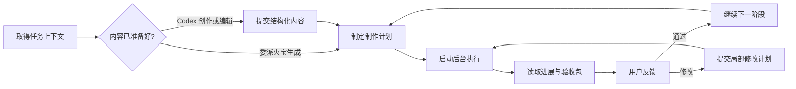

# 火宝 MCP v2：面向大模型的制作工作接口

状态：历史设计提案，尚未实现。日期：2026-10-04。已由 [独立扩展 v3 方案](./mcp-service-design.md) 替代。

本版保留面向模型的任务设计参考；涉及修改原服务端、事务、版本控制及任务恢复的设计不再作为实施依据。当前硬约束是原服务端代码不可修改，以 v3 为准。

本方案替代 [v1](./mcp-service-design-v1.md) 的工具设计和实施顺序。[网页差异表](./mcp-web-feature-diff.md) 只作为业务能力调查，不再以网页按钮、页面或旧 HTTP 路由的一对一覆盖衡量 MCP。

## 1. 设计目标

模型应能回答并执行四件事：

1. 这个作品要做成什么样，目前做到哪里？
2. 为了用户的当前要求，需要读取什么、修改什么、执行什么？
3. 哪些工作火宝可以自行完成，哪些结果需要用户判断？
4. 调用失败、用户修改意见、会话中断之后，如何可靠地继续？

用户负责创作意图与质量取舍；Codex 负责理解、创作、判断和安排；火宝负责确定性的生产规则、专业生成任务、执行、版本、存储与进度。

**工具以制作意图与产物组织。内部复杂度由火宝承担；关键决定与实际结果对模型可见。**

网页与 MCP 共享业务数据、资产身份和任务状态，但不共享操作步骤。网页保留人类熟悉的编辑器、预览、筛选与按钮；MCP 提供上下文、批量内容提交、生产计划、持续任务和结构化反馈。

## 2. 与 v1 的主要变化

| v1 设计重心 | v2 设计重心 | 对模型的收益 |
| --- | --- | --- |
| 为每类对象提供大量 CRUD 工具 | 围绕上下文、创作提交、制作计划、验收反馈提供工具 | 减少选工具与拼接步骤的负担 |
| 先完成单项功能映射，再补工作流 | 第一条可用链路就包含计划、执行、等待验收与恢复查询 | 更早验证用户希望的工作方式 |
| 列表/详情大量读写 | 摘要优先、按任务取上下文、按需展开原文 | 减少重复读取与上下文占用 |
| Codex 遍历对象调用生成 | 火宝解析目标集合、补依赖、控制并发、处理部分失败 | 模型不充当队列与轮询脚本 |
| 主要委派火宝内部 Agent | Codex 直接创作与内部 Agent 委派并存 | 避免每次都让另一个模型重写已有内容 |
| 工具返回“成功”和裸对象 | 返回变更、完成范围、阻塞原因和可继续动作 | 模型能判断业务是否真正完成 |
| 追求网页操作相同 | 保证同一份作品与结果，允许交互和默认策略不同 | 网页适合人操作，MCP 适合模型工作 |

## 3. 模型面对的工作循环



`plan → start` 是可审计、可重试的调用契约，不要求每次都打断用户确认。用户已经授权的范围内，Codex 可以检查计划后直接启动。仅在用户设置的质量检查点、缺少必要创作决定或超出已有范围时停下。

“执行到分镜”“仅重做所选镜头”“导出一个已有片段”都采用同一计划机制。计划可只有一步，不要求小操作经过整集流程。

## 4. 以作品为中心的领域对象

| 对象 | 含义 | 对模型暴露的信息 |
| --- | --- | --- |
| Project / Episode | 作品及一集内容 | 稳定 ID、名称、摘要、当前版本 |
| Brief | 创作约束 | 题材、受众、目标时长、画幅、风格、语言、连续性要求和明确禁改项 |
| Script / Asset / Shot | 剧本、共享素材、镜头 | 内容版本、稳定引用、关联、当前采用产物 |
| Plan | 一次准备执行的工作 | 目标、选中对象、依赖、复用项、生成项、检查点和资源上限 |
| Run | 一次持久化执行 | 当前步骤、进度、已完成/失败/结果不明项和停止原因 |
| Artifact | 可查看和选用的产物 | 版本、来源、输入版本、可访问预览和当前采用状态 |
| Review | 一份确定版本的验收包 | 待判断对象、产物对照、已有意见与决定 |

镜号只用于展示，镜头 ID 用于操作。结果同时返回 `shot_id`、当前镜号、短标题，避免“第 5 镜”在重排后指向另一个对象。角色改名不改变资产 ID。

Brief 是持久化创作依据，不是聊天记录副本。来自用户的硬约束、Codex 的建议和已经接受的决策分开记录；不能把模型猜测自动升级为用户要求。

## 5. 默认工具面：16 个工具

下列是候选工具契约，数量不是硬指标；通过实际任务评测决定是否拆分。每个工具有明确输入输出 schema，不以 `action + 任意 JSON` 的万能工具压缩数量。

### 5.1 找到作品并获得工作上下文

| 工具 | 模型为什么调用 | 主要输入 | 返回 |
| --- | --- | --- | --- |
| `hb_find_projects` | 从用户描述定位作品 | query、状态、分页 | 候选项目、摘要、进行中的 run；不会自动选同名项目 |
| `hb_create_project` | 建立一个作品的创作起点 | title、brief、可选首集标题 | project_id、episode_id、已采用的默认值、缺失生产条件 |
| `hb_get_context` | 知道当前要做什么及可做什么 | project_id、可选 episode_id、focus、已知 revision/cursor | 精简上下文、约束、状态、缺失项、相关对象引用、可执行动作 |
| `hb_read_content` | 按需读剧本、镜头、素材或具体产物 | 类型化 ref、视图、分页/区段 | 对应正文或细节、revision、截断与继续读取信息 |

`focus` 首版固定为 overview / writing / assets / storyboards / production / revision / capabilities，不接受需要再调用模型理解的任意“上下文需求描述”。正文与创作内容保留原语言，业务字段固定。

capabilities 视图允许不传项目，返回当前可用工具/生产目标、缺失配置及输出限制；其余视图要求明确 scope。create_project 默认可建一个空白首集，首集标题可省略；不会自动调用任何模型。

创建项目或录入剧本不应因尚未配置图片/视频模型失败。当前“创建剧集就要求两类模型”的约束在新业务实现中调整为“执行对应生成步骤前验证能力”；旧页面可继续推荐先配置。

### 5.2 直接提交创作结果

| 工具 | 模型为什么调用 | 主要输入 | 行为 |
| --- | --- | --- | --- |
| `hb_update_brief` | 将用户的新要求写成持久化约束 | scope、expected_revision、指定字段、要求来源 | 返回变更及对后续生产的影响 |
| `hb_write_script` | Codex 自己完成创作或修稿 | episode_id 或 new_episode、expected_revision、原文/剧本类型、正文 | 原子保存一个版本，不自动再请内部 Agent 改写 |
| `hb_upsert_assets` | 一次提交角色/场景/道具及关联 | episode_id、带类型的 items、各项 revision | 校验、创建/更新、建立关联、返回稳定引用映射 |
| `hb_write_storyboards` | 一次提交分镜或精确修改 | episode_id、集合 revision、mode、shots | 批量校验、稳定 ID、绑定解析、事务提交 |

内容提交工具可以采用 `commit` 或 `draft` 模式；默认 commit 适合用户已授权的普通编辑。整集替换采用已准备好的完整内容和预期版本检查；需要分多次写的大集使用 draft_id 累积，再显式提交。模型中断时旧正式内容保持完整。

批量新对象允许客户端局部引用 `client_ref`，火宝返回其到稳定 ID 的映射。镜头绑定优先使用已知 ID；如用名称辅助匹配，只允许唯一匹配，歧义返回候选列表，不静默猜测。

`hb_upsert_assets` 不凭同名直接覆盖既有角色：更新必须带 ID 和 revision；新增发现近似对象返回 duplicate_candidate，由 Codex 决定复用、变体或新建。删除/移除使用明确的 retire_ids/unlink_ids 等字段并返回影响清单，不把“本批未提到”解释为删除。

批量写入携带集合 base_revision 和各已存在对象的 revision。新增项 client_ref 在该项目的命令收据中稳定登记，响应丢失后可复用；合法地创建同内容的另一个对象使用新的 client_ref，不做跨所有历史数据的内容 hash 去重。

`hb_write_storyboards.mode` 仅 merge / replace，replace 是明确整体替换；未改动镜头保留身份和产物，新镜头与退休镜头明确报告。不能仅按镜号把旧视频挂到新内容。

### 5.3 让火宝承担连续生产

| 工具 | 模型为什么调用 | 主要输入 | 返回 |
| --- | --- | --- | --- |
| `hb_plan_production` | 把任务目标转成可执行的生产计划 | scope、target、选取规则、生产策略、检查点 | plan_id、版本、精确对象集合、步骤、复用/生成数量、阻塞、资源预估 |
| `hb_start_run` | 执行已经检查过的计划 | plan_id、plan_revision | run_id、当前状态、下次查询建议；同计划启动重放返回同一 run |
| `hb_get_run` | 了解执行变化，不反复拉全量数据 | run_id、since_cursor、可选短 wait_ms | 进度变化、失败/阻塞、产物摘要、review_id、下一步 |
| `hb_control_run` | 对已存在执行做明确控制 | run_id、expected_revision、枚举 command | pause / resume / cancel / retry_failed 的实际结果和未完成事项 |

生产目标用业务枚举：script / asset_images / storyboards / shot_videos / export。target 是期望产物，火宝基于现状补必要依赖，也可以复用已存在且有效的结果。

选择器是确定性的：`all`、`missing`、`failed`、`stale` 或显式 IDs。计划保存实际选中集合；执行时不再按模糊规则重新扩张。目标为已全部完成的 missing 选择时返回 noop，不重做。

创作模式分两种：

- `provided`：使用 Codex 已提交的内容。缺内容就返回缺失项，不自动请另一个模型补写。
- `delegate`：火宝内部 Agent 按 brief 和现有专业规则生成草稿。只在计划里明确授权的步骤使用，返回草稿和版本信息。

显式模型覆盖用于用户明确指定模型时；常规调用使用实例配置的 production profile。模型 ID/厂商请求参数、素材格式转换、FFmpeg 选项由火宝解析，计划返回实际生效配置。`quality_profile` 首版只提供用户已配置并可解释的 profile，不能把“高质量”当作随意切换昂贵模型的许可。

### 5.4 看结果、处理反馈和局部返工

| 工具 | 模型为什么调用 | 主要输入 | 返回 |
| --- | --- | --- | --- |
| `hb_get_review` | 汇总待验收结果，准备向用户展示 | review_id 或 scope、视图、分页 | 确切版本、文字差异、图像对照、视频链接、待决定项 |
| `hb_record_review` | 记录用户已经明确给出的取舍 | review_id、expected_revision、逐项决定、意见、来源 | 已通过/退回项、是否可继续、下一阶段计划建议 |
| `hb_revise_production` | 将反馈落实为有限范围的返工 | 精确目标 IDs、结构化修改、反馈说明、保留约束 | revision_plan_id（同 Plan 类型）、影响范围、拟复用/重做项；不直接付费执行 |
| `hb_select_artifact` | 采用用户选中的一个具体版本 | target_ref、artifact_id、expected_selection_revision | 当前采用版本、被替换版本、下游是否过时 |

`hb_revise_production` 不是另一个自由聊天 Agent。“第三镜太快”由 Codex 解释为具体镜头与可执行修改，例如增加时长、调整动作/台词分配，再交给火宝验证影响；原意见作为依据保存。只有用户或 Codex 明确选择 delegate 时，才将改稿委派给火宝内部 Agent。

影响范围可约束为 `selected_only`。修改共享角色图片若实际会影响其他镜头，计划必须报告超出范围，返回局部角色变体/扩大范围等可选动作，不能悄悄重做整集。

### 5.5 可选扩展组

`hb_import_media`：上传/关联外部图片或视频，返回可用 artifact；正文走上传通道，MCP 不传巨大 base64。只有可读本机目录的客户端或桥接才支持 local_path。

`hb_manage_project`：归档、恢复、删除等低频项目维护，操作枚举与 schema 固定。

`hb_configure_production`：管理 production profile 或已有配置引用；密钥管理仍可留在设置页。出现 MODEL_NOT_CONFIGURED 时返回准确的设置位置与缺失类型即可，不要求模型掌握整套设置页面。

初期不默认开放主题、导航、软件更新、存储迁移、任意 Prompt/Skill 管理。只有真实自动化任务需要时再加入独立工具组；不以工具数量或网页覆盖率作为目标。

## 6. 上下文设计：返回模型做下一步决定所需的信息

### 6.1 内容分层

| 层次 | 内容 | 默认策略 |
| --- | --- | --- |
| 项目约束 | brief、已确认创作决定、风格/语言/连续性要求 | overview 包含精简版，完整内容按需读 |
| 工作状态 | 当前正式版本、活跃 run、待验收、stale 与阻塞 | 每次 get_context/get_run 都能重新获得 |
| 任务上下文 | 写作所需剧本；返工所需镜头与关联资产；生产所需配置 | focus 决定范围，避免全库灌入 |
| 原始内容 | 小说全文、全部 Prompt、完整历史 | 只通过 read_content 分段读取 |
| 媒体 | 选用版本、缩略图、对比页、视频地址 | 默认元数据和预览，按能力返回图像内容块 |

初始大小预算：context 文字内容约 8,000 字符以内，列表默认 20 项；实际通过评测调整。预算不足时保留阻塞和约束摘要，返回 `truncated`、`omitted_sections`、`next_cursor` 和完整内容引用。不得静默截断关键约束，也不得把摘要当作完整原文。

新会话可按 project/episode 获取正在进行的 run 和最新 review，不必持有旧会话隐藏状态。cursor 过期返回摘要并标记 reset，不能漏报变化。

### 6.2 结果协议

读工具返回对应内容与版本；写/执行工具返回少量通用字段，避免所有响应都带完整工程对象：

```json
{
  "outcome": "blocked",
  "scope": { "episode_id": 3 },
  "revision": 12,
  "summary": "第 3、7 镜缺少已绑定角色的图片，暂不能生成视频。",
  "blockers": [
    {
      "code": "MISSING_ASSET_IMAGE",
      "asset_id": 8,
      "affected_shot_ids": [31, 35],
      "recoverable": true
    }
  ],
  "next_actions": [
    {
      "tool": "hb_plan_production",
      "arguments": {
        "scope": { "episode_id": 3 },
        "target": "asset_images",
        "selection": { "mode": "ids", "ids": [8] }
      },
      "reason": "先补齐两镜共用的角色图片"
    }
  ]
}
```

以上为业务 DTO 示例，非完整 JSON-RPC。`outcome` 为 ok / queued / noop / blocked / conflict / failed；run 另有精确状态。已运行批次的失败通过结构化 item_results 返回，不把一次部分失败伪装成全量失败或全量成功。

预检发现阻塞或等待验收属于成功查询的业务结果；真正的参数错误、写入冲突、调用失败映射为 MCP 工具错误并保留可操作详情。已失败任务的查询仍是成功读取，不能让客户端把它误当作查询请求失败而反复重试。

next_actions 来自固定业务逻辑，只建议已注册的工具与明确参数，不执行、不扩大授权。用户输入、小说正文、模型输出单独作为 content/data 返回，不允许其伪装为系统动作建议。

错误要说明模型能采取什么行动：版本冲突给当前版本及重读入口；名字歧义给候选；模型缺失给配置需求；结果不明给查询/人工核实入口。纯“400/操作失败”不足以支撑自动恢复。

## 7. 计划与执行契约

### 7.1 计划需要包含什么

scope、目标产物、实际选中对象、输入版本清单、复用项、拟新增/修改项、依赖步骤、采用策略、检查点、有效模型、资源上限、阻塞、plan_revision 和 plan_hash。

数量、时长、价格分开表达：已有分镜时可以给精确镜头数；分镜尚未生成时只给估计/范围和执行上限。没有可靠价格时 `estimated_cost=null` 并说明 unknown，不能编造金额。提供 `max_new_generations`、`max_total_video_seconds` 等可执行上限；扩张超过上限则等待重新规划。

plan_production 可以持久化一个小计划，但不生成内容、不变更当前选用产物、不调用付费 Provider。start_run 在短事务中核对计划、版本及幂等，再提交执行。

### 7.2 自主推进与停止

默认策略：复用当前有效产物；只补缺失/过时项；已有采用版本不因重生成而替换；先完成请求范围内的工作，再返回 next_actions。

`stop_after=storyboards` 表示本次范围到分镜结束；这次 run 可以完成，但整集仍未完成。`review_points` 指定质量检查点，检查点到达后为 awaiting_review，而不是伪装为整集 succeeded。

部分依赖需先生成内容才能展开：例如剧本之后才知道有多少镜头。执行器只可在保存的 brief、模板和资源上限内展开；记录已展开计划。涉及新创作决定、超量生成或改变已确认内容时返回 blocked/awaiting_review。

等待审核时停止派发新任务；已在途的 Provider 任务可继续完成并保留产物。MCP 请求结束、Codex 退出不终止持久化 run；桌面整个应用关闭则后端也退出，常驻运行需要服务器部署。

run 状态固定为 queued / running / awaiting_review / paused / blocked / needs_attention / succeeded / failed / cancelled。已中断但未能自动恢复的任务归入 needs_attention，并带 interrupted 原因；进度同时返回 completed/failed/running/total 与实际完成范围。

### 7.3 幂等、重试与取消

- start_run 同一 plan_id 只创建一个 run，网络超时重发返回同一 run；重新制作一个版本先创建新计划。
- 直接内容写入使用目标版本与规范化内容 hash 生成命令指纹；重复同一写入返回原收据。先识别已提交命令，再判旧 revision，避免成功响应丢失后被误报冲突。
- 新建项目尚无目标 ID，单独要求稳定的 creation_key；同一创建意图重发复用该 key，新作品使用新 key。新建剧集以项目内 new_episode.client_ref 区分。不声称仅凭相同标题就能实现正确的创建幂等。
- control_run / record_review / select_artifact 使用预期版本与动作指纹幂等，不让模型为每个调用自行发明随机 request_id。
- retry_failed 保留成功项并创建新 attempt；结果不明的提交不是普通失败，不能自动重发。
- 已记录 provider_task_id 的任务重启后恢复查询；提交可能送达但没拿到 ID 时 needs_attention。只能重试下载的故障不重新生成。
- queued 可取消；上游已受理时按实际取消能力处理，不能把删除数据库记录当取消，也不能承诺停止计费。
- pause/resume/cancel 是既有 run 的有界枚举，不接受随意脚本。resume 必须重新检查必要验收和输入版本。

get_run 默认立即返回；wait_ms 上限 10 秒，仅减少短时间轮询，返回 poll_after_ms 指导后续查询。长时间制作不要求一个 MCP 调用持续占用连接；宿主是否支持后台通知属于客户端能力，不能在未配置调度时承诺 Codex 会自行醒来通知用户。

## 8. 验收与反馈

验收包是模型与用户共同讨论的对象。包含 review_id、精确内容/产物版本、改了什么、与上一版本的对照、待选项和可打开的页面链接。

图片提供缩略图/对照图；视频提供可播放链接及必要的海报/抽帧。若客户端无法播放视频，明确说明观察范围；不能依据海报自动声称视频的动作、口型和节奏合格。模型的检查结论作为 advisory，用户的质量决定另存。

用户在网页操作，或明确在 Codex 中说“这些通过”“第三镜退回”后，可记录用户决定。`source=web_user` 与 `source=mcp_delegated` 区分来源；服务器不能仅凭模型传参证明是人类授权。需要强制网页验收时启用 ui_only。默认个人协作支持 Codex 转达，避免每一步都要求用户回网页点击。

修改后新建版本，原审核记录保留但对新版本不自动有效。对象级决定支持“其他镜头通过，第 3 镜退回”，后台等待的依赖仅限未通过项。人工设置剧集 completed 与工作流验证成功分开，不用一个字段承担两种含义。

## 9. 三个典型调用路径

### 场景 A：从原文做到分镜，等用户看

```text
hb_create_project(title, brief)
hb_write_script(episode_id, kind=raw, content)
hb_plan_production(target=storyboards, authoring_mode=delegate,
                   stop_after=storyboards, review_points=[storyboards])
hb_start_run(plan_id, plan_revision)
hb_get_run(run_id, since_cursor)
hb_get_review(review_id)
→ Codex 向用户展示剧本/角色/分镜摘要与预览链接
```

若 Codex 自己写剧本和分镜，则先用 write_script/upsert_assets/write_storyboards 提交，生产计划用 provided。实际方案允许不生成资产图片就先审文字分镜，避免在方向未确定时先花费生图。

### 场景 B：第三镜节奏太快，其他不要动

```text
hb_get_context(episode_id, focus=revision)
hb_read_content(ref=shot_id, view=production_context)
→ Codex 理解原意见，明确时长/动作/台词调整
hb_revise_production(targets=[shot_id], typed_changes, preserve=selected_only)
→ 返回仅该镜头和相关合成受影响的计划
hb_start_run(revision_plan_id, plan_revision)
hb_get_run(run_id)
hb_get_review(review_id)
hb_record_review(review_id, 用户决定)
```

意见过于含糊且修改选择会明显影响作品时，由 Codex问用户具体取舍；火宝不自行猜出不可逆的创作修改。

### 场景 C：换一个 Codex 会话继续制作

```text
hb_find_projects(query)
hb_get_context(project_id, episode_id, focus=overview)
→ 得到最新约束、进行中的 run、待验收和阻塞
hb_get_run(run_id, since_cursor)
→ 根据真实状态等待、取验收包或继续计划
```

不需要重放聊天历史、枚举所有数据库表或重新执行成功步骤。模型负责如何解释与处理状态，火宝持有状态本身。

## 10. 内部实现：复用现有能力，补模型交互需要的深度

继续使用 codebase-design 的 Module / Interface / Seam / Adapter 原则。HTTP 与 MCP 是两个 Adapter，共享业务 Module 的 Interface；模型可通过少量调用完成复杂制作动作。

建议聚合为四个主要 Module，避免为了每个 MCP 工具新增一层转发文件：

| Module | 负责行为 | 主要复用/改造位置 |
| --- | --- | --- |
| Context | 作品快照、相关内容、能力和下一步 | dramas/episodes/tasks 查询、配置脱敏、共享 DTO |
| Editorial | brief、版本、批量创作提交、绑定、草稿与采用 | routes CRUD、Agent 写入工具、分镜集合提交 |
| Production | 计划、依赖、批量、任务、重试、恢复、Provider 调度 | generation、extraction、video-prompts、ffmpeg-merge |
| Review | 验收包、版本对照、用户决定、返工影响 | 现有视频历史/选用能力、新验收与依赖记录 |

不做通用任意 DAG 平台。首版使用固定制作步骤及依赖，支持目标阶段和对象集合选择；任务实际复杂后再扩展模板。

必须从前端移入共享业务实现的内容：参考素材排序/@引用转换、有效模型解析、批量范围选择、生成参数预检、任务完成后选用回写。前端本地显示偏好不要求同步到 MCP。

必须调整的当前实现：

- `/agent/:type/chat` 与各异步 Map 任务统一提交到持久化执行器。
- `generation.ts` 中 detached 调用变成 worker 单一执行，启动时不再把新机制任务统一标失败。
- Agent 写入必须经过同一版本/草稿 Interface；整集拆分不得先删旧内容再等待模型完成。
- 图片/视频完成采用“产物落盘 → artifact 入库 → 有条件采用 → 最终成功”的一致性提交。
- 素材资料变化后的 Prompt 保留/失效规则统一放到 Editorial，消除当前页面与后端不同口径。
- 全量导出与部分导出明确区分；模型请求“整集成片”时不能静默跳过缺失镜头。

### 最小数据补充

新增/扩展概念：brief 与对象 revision、plans、runs/run_steps、jobs/attempts/events、artifacts 与选用指针、drafts、reviews/decisions、命令收据。具体表可按生命周期合并，不以表数量作为架构目标。

保留 sys_task / video_merges 的历史和兼容投影，避免破坏已有页面。任务快照保存模型配置身份、Prompt/Skill 版本与输入引用，不保存明文密钥。采用版本变化可让依赖产物 stale，进度/海报补全不应让编辑 revision 无意义增长。

短事务处理关联、版本、命令收据与入队；网络和 FFmpeg 不持有事务。worker 使用数据库租约与完成时的租约 token 校验。外部生成无法与本地事务统一成 exactly-once，未知受理结果必须显式表达。

### 页面刷新与共享数据

模型提交正式内容/选用产物后，现有业务投影同步更新；页面刷新可看到。草稿在草稿区展示，候选在历史/候选区展示，不冒充当前采用版本。动态内容查询 no-store，媒体 URL 不可变。

原始内容编辑器处理 dirty 状态与 revision 冲突。模型临时覆盖配置不强行改变网页的本地模型选择；任务记录显示真实使用的配置。网页语言/主题不属于作品数据同步承诺。

### 协议与部署

同一后端提供 `/mcp`，复用官方 TypeScript SDK。传输适配不拥有作品状态；run/plan/review 均是显式持久化 ID。短查询或增量 get_run 足以工作，不把后台执行绑定到长连接。

stdio 如需要，只作为现有后端的桥接。桌面动态端口通过实例发现解决，不启动第二份数据库/worker。本地连接限制实例访问并保护凭据；远程部署统一保护 MCP、业务写入口与媒体。模型查询永不回显 Provider 密钥。

协议细节由 SDK 与客户端兼容测试决定；支持结果 schema、结构化结果及可操作错误，参见 [MCP 工具规范](https://modelcontextprotocol.io/specification/2026-07-28/server/tools) 与 [官方 SDK](https://ts.sdk.modelcontextprotocol.io/v2/migration/support-2026-07-28)。不以某个新增协议扩展作为业务闭环的硬依赖。

## 11. 实施顺序重排

| 阶段 | 交付目标 | 本阶段证明什么 |
| --- | --- | --- |
| A：模型工作闭环 | 上下文、直接内容提交、制作计划、持久化 run、文字验收包；贯通原文→剧本→资产描述→分镜 | 模型可以用少量有意义的调用完成一个阶段，并让用户接管质量判断 |
| B：媒体生产闭环 | 资产生图、批量视频、候选/选用、媒体验收、完整/部分合成；具备幂等和结果不明保护 | 模型不需管理 Provider 细节，用户能看到可验收的真实产物 |
| C：复杂返工与持续运行 | 局部返工、依赖失效、跨集共享素材影响、完善重启恢复/取消与批次控制 | 中断、反馈和失败后的继续工作可解释、可追溯 |
| D：按需扩展 | 外部媒体导入、生产配置工具、桌面连接、远程部署适配 | 按实际工作需要补能力，不进行网页按钮搬运 |

每阶段都包含相应任务的持久化和明确错误状态。C 的完整恢复之前，A/B 中断任务至少进入可查询的 interrupted/needs_attention，不默默消失或重复付费提交。16 个工具是最终默认面，尚未交付的工具不注册假入口；能力发现只报告真实可用目标。

先在隔离测试数据库上跑闭环，再迁移实际数据。版本化迁移备份旧库，保留业务 ID、历史任务与媒体 URL；不触碰当前其他未提交修改。依赖、Hono、Node/Electron 与客户端协议的兼容验证属于 A 的前置工作。

## 12. 用模型任务成功率验收设计

| 评测任务 | 应达到的结果 | 需要记录 |
| --- | --- | --- |
| 给一个原文，做到分镜待审 | 无需用户逐项解释数据结构或后台参数；实际停止在约定节点 | 工具选择错误、调用数、上下文字符量、人工纠正次数 |
| Codex 直接写入角色和分镜 | 批量关联正确，无需重复经过内部模型重写 | 绑定错误、重复资产、版本冲突 |
| 仅修改一个镜头 | 计划明确局部影响，其他镜头不重新计费生成 | 实际重新生成集合与请求集合 |
| 相同调用因网络超时重发 | 同一计划一个 run，已提交内容返回原收据 | 重复记录、重复 Provider 提交 |
| 一批生成部分失败 | 成功项可用、失败项有原因、只重试适合重试的项 | 部分成功是否被误报、恢复步骤数 |
| 更换会话/重启后继续 | 查询恢复当前状态，不需要用户重述全部过程 | 重新获取上下文成本、状态遗漏 |
| 旧结果晚返回、网页同时编辑 | 不覆盖新版本与人工选用，候选结果仍可追溯 | 丢失编辑、错误采用 |
| 查看视频验收包 | 明确可观察的范围，最终质量取舍由用户决定 | 将海报误当视频验收、误记通过 |

对比 v1 的逐项调用基线，目标是减少不必要的工具调用与重复正文读取，同时保持可解释性。首先用固定样例和假 Provider 记录基线，再以少量明确范围的真实生成做端到端验证；没有测量前不宣称节省了多少比例的 token 或时间。

不以“16 个工具越少越好”为标准。若某工具的 schema 过大、调用错误多，应按明确任务拆分；若模型反复执行同一串无决策操作，应把那串行为收进火宝 Module。
