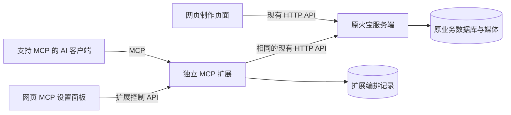

# 火宝 MCP v3：复用现有服务端的独立扩展

状态：当前设计基线，已落地首个可用实现。日期：2026-10-04。具体交付范围、启动方式和未实现项以 [扩展 README](../extensions/huobao-mcp/README.md) 为准；下文仍保留后续目标。

本方案保留 [v2](./mcp-service-design-v2.md) 面向模型的工具设计，替代其中需要改造原服务端的实现。用户的硬约束是：**原服务端代码不能修改；MCP 是可选扩展；网页增加 MCP 开关。** [网页差异表](./mcp-web-feature-diff.md) 作为业务调查保留，不以网页功能一对一覆盖作为验收目标。

## 1. 职责与改动边界

用户决定创作方向、判断质量；接入的 AI 客户端理解需求、创作内容、选择下一步；MCP 扩展组织调用、记录进度和反馈；火宝现有服务端负责原有业务校验、生成、媒体处理及业务存储。Codex 仅作为使用示例，不是运行依赖。

### 客户端无关性

- 通过标准 MCP 暴露工具，不依赖 Codex API、任务 ID、私有配置或特定模型的消息格式。
- 首期采用 Streamable HTTP，让多个客户端连接同一个扩展实例、共享开关和运行记录。客户端仍需支持所选传输方式与认证配置，不能只凭“支持 MCP”就承诺兼容。
- 如需兼容仅支持 stdio 的客户端，提供连接同一扩展的薄桥接入口；不为每个客户端启动独立编排引擎或绕过网页开关。
- 运行归属和续作使用扩展自己的 ID，不依赖客户端会话。更换客户端后，在相同授权范围内可以查询并继续运行；客户端本身的聊天历史不会随之迁移。
- 工具结果提供结构化数据及可读文本摘要；媒体提供引用和说明，核心流程不依赖专属卡片或弹窗。
- 验收包含标准 SDK 协议测试和至少两种实际客户端接入；未验证的客户端明确列为未验证，不宣称全部兼容。

| 区域 | 本次允许的改动 | 边界 |
|---|---|---|
| `backend/**` | 不新增任何改动 | 不改路由、服务、Agent、数据库结构、依赖或内部配置实现；保留用户已有改动 |
| 原业务数据库和媒体目录 | 只通过现有 HTTP 接口操作 | 不直连 SQLite，不新增业务表、触发器或补丁，不直接改媒体文件 |
| `extensions/huobao-mcp/` | 新增独立包和进程 | 不导入 `backend/src`，只依赖既有 HTTP 契约 |
| 扩展独立数据目录 | 新增编排记录存储 | 保存计划、运行记录、调用凭据索引、审阅意见；不成为第二套业务数据源 |
| 前端 | 新增 MCP 设置面板及连接逻辑 | 原有制作页面继续直连原服务端 |
| 启动与部署 | 可新增启动命令、sidecar 配置和外部反向代理 | 不把 MCP 嵌入原服务端进程；桌面打包适配单独实施 |

扩展停止、卸载或发生故障，原网页与原服务端仍可照常使用。不新增 Provider SDK、生成引擎或 FFmpeg 实现；这些能力通过原接口复用。

## 2. 架构



原服务端仍是业务数据的唯一权威来源。扩展通过 `HUOBAO_API_BASE_URL` 绑定网页使用的同一个后端；不允许模型每次调用指定任意后端 URL。扩展启动时检查连接及所需路由，能力不足则明确返回不支持，不采用直接访问数据库的替代路径。

建议原服务端沿用现有端口，扩展示例使用 `5680`，实际端口可配置。扩展分别提供 `/mcp` 与 `/control/*`，两者使用不同权限。

### 网页如何连接扩展

| 运行方式 | 接入方式 |
|---|---|
| 当前 Nuxt 开发环境 | 在 `frontend/nuxt.config.ts` 增加 `/mcp-extension` 到扩展的开发代理；现有 `/api`、`/static` 保持原路由 |
| 静态网页部署 | 部署层反向代理将 `/mcp-extension/*` 转发到扩展；静态 SPA 自身不能提供这个代理 |
| 无同源代理的独立部署 | 显式配置扩展地址、允许的网页 Origin 和认证；需适配浏览器跨域及本地网络访问限制 |
| Electron | 后续由桌面主进程启动扩展并传入实际后端端口；不能假定桌面后端固定使用 `5679` |

优先同源反向代理，避免 HTTPS 页面访问 HTTP 扩展的混合内容问题。远程网页中的 `localhost` 指向浏览器所在机器，部署时不能将其误当成服务器地址。

当前原接口没有可直接依赖的稳定服务实例身份。本期展示后端配置地址，并通过项目元数据辅助检查绑定；这不等于证明两端连接了同一数据库。扩展切换后端绑定时隔离历史运行记录，不能将旧对象 ID 直接用于新后端。

## 3. 网页开关：控制 MCP 能力，不承担进程启动

在现有设置页增加“MCP 服务”分类。开关状态持久化在扩展端，不只写浏览器 `localStorage`。

**扩展进程保持运行，开关控制它是否接受 MCP 调用、派发制作步骤。** 普通网页无法启动一个尚未运行或未安装的本地程序；若关闭整个进程，网页也无法再次打开它。因此 `/control/*` 在开关关闭后继续运行，生产执行入口关闭。

首次启动默认关闭。通过独立启动命令、开发组合启动命令或容器启动扩展；启动安装属于部署步骤，开关属于日常使用。无需更改原服务端启动代码。

| 状态或动作 | 网页表现 | 扩展行为 |
|---|---|---|
| 未安装或未启动 | 显示“扩展未连接”、启动说明及重试；开关不可操作 | 不伪造开启成功 |
| 已连接、关闭 | 显示关闭状态 | 允许控制 API，拒绝 MCP 业务调用 |
| 开启 | 检查原服务端连接，成功后显示开启 | 持久化状态，允许新调用及新运行 |
| 关闭 | 提示已提交任务仍可能继续 | 拒绝新 MCP 调用，停止派发排队及后续步骤 |
| 已提交的生成或 Agent 调用 | 保留任务状态与说明 | 原服务端继续执行；可只读跟踪结果，不提交下一生产步骤 |
| 扩展重启 | 从扩展读取真实状态 | 恢复持久化开关；关闭状态绝不自动开启 |
| 后端不可达 | 单独显示连接故障 | 不将故障误显示为用户已关闭；不派发生产任务 |
| 重新开启 | 新任务可用，旧暂停运行可手动继续 | 旧运行不因开关开启而自动恢复批量生产 |

关闭动作与步骤派发需要在扩展内串行协调：关闭完成后不再授予新的派发许可；已获许可并在途的请求无法撤回。已有 MCP 客户端即使缓存了工具列表，也必须在每次工具调用及每一步派发时重新检查开关。

特别注意：一次已提交的火宝 Agent 调用可能包含多次内部生成或写入，扩展无法在它内部插入暂停点。网页应明确“已提交的任务可能继续修改作品”，不能把断开 HTTP 连接当作取消。

### 面板内容与扩展控制接口

面板包含连接状态、开关、绑定后端、MCP 地址、复制连接配置、运行中/待审阅数量、近期运行记录及恢复入口。切换过程中显示提交状态；失败后重新读取实际值。多窗口使用状态版本，避免后打开的旧页面覆盖新设置。

以下均为**扩展新增接口**，不是原火宝新增接口：

| 接口 | 作用 |
|---|---|
| `GET /control/status` | 返回开关、后端健康、状态版本、运行数量；不返回密钥 |
| `PUT /control/enabled` | 使用 `enabled`、`expected_revision` 修改开关；冲突时要求刷新状态 |
| `GET /control/runs` | 查询扩展运行及审阅状态 |
| `POST /control/runs/:id/resume` | 在服务开启时显式恢复暂停运行 |
| `POST /control/client-config` | 网页显式获取连接配置；不混入普通状态响应 |

按用户要求，网页控制面无需配对码、登录或会话 Cookie，连接后直接管理开关并获取连接信息。保留 Host 和网页 Origin 校验；这些检查不是身份认证。MCP 工具入口仍使用 Bearer Token，前端构建产物不包含密钥。远程部署如需限制管理访问，由外部网关处理。

远程部署若需要限制整个系统访问，网关还应覆盖原 API 和媒体入口；仅保护扩展不能为原来未鉴权的接口补上鉴权。这属于外部部署配置，不修改原服务端代码。

## 4. 模型工具仍按制作任务组织

延续 v2 的 16 个候选工具名称，按实际可兑现能力精简字段和注册范围。不是将网页按钮逐一改成工具，也不通过通用 `call_api` 把内部 HTTP 细节全部交给模型。

| 工具 | 独立扩展的实现方式 | 本期约束 |
|---|---|---|
| `hb_find_projects` | 查询现有项目接口，返回紧凑摘要 | 不维护独立项目副本 |
| `hb_create_project` | 调用创建项目及可选剧集接口 | 多步创建可能部分成功；剧集仍受原模型配置前置条件约束 |
| `hb_get_context` | 聚合项目、剧集、资产、分镜、任务信息 | 附观察时间；多次 HTTP 查询不是一致性数据库快照 |
| `hb_read_content` | 按对象和字段读取原文、剧本、分镜及产物引用 | 分页、限量，不默认倾倒全项目 |
| `hb_update_brief` | 原生字段走更新接口；额外制作要求写扩展记录 | 扩展专属要求不会自动出现在原业务页面 |
| `hb_write_script` | 调用剧集内容更新接口 | 不提供原服务端不支持的版本 CAS |
| `hb_upsert_assets` | 校验后逐项调用素材接口 | 返回逐项结果；不支持的跨剧集挂载明确拒绝 |
| `hb_write_storyboards` | 使用现有分镜及关联接口 | 默认精准增改；不暴露非原子的全量替换 |
| `hb_plan_production` | 读取当前上下文，形成有明确对象和步骤的执行计划 | 标出预计请求数、缺项及可能覆盖的字段；费用未知则注明未知 |
| `hb_start_run` | 固化计划并派发现有生成/拼接接口 | 返回扩展运行 ID 和原任务 ID，不长时间阻塞工具调用 |
| `hb_get_run` | 汇总扩展记录与原任务查询结果 | 无原任务查询能力时不能伪造恢复结果 |
| `hb_control_run` | 暂停、恢复扩展步骤派发 | 不承诺取消已经提交给原服务端的任务 |
| `hb_get_review` | 汇总产物引用、用户意见及待审阅项 | 原生媒体从原接口读取；审阅状态保存在扩展 |
| `hb_record_review` | 记录针对具体对象、产物的意见和决定 | 原生数据变化后，旧审阅结论标为待复核 |
| `hb_revise_production` | 将反馈转为限定对象的修改/重做计划 | 不因一处反馈默认重跑整集 |
| `hb_select_artifact` | 通过原更新接口选择仍可访问的历史产物 | 不保证原文件永久保留；不提供虚构的完整版本系统 |

上下文和运行结果优先返回 `summary`、目标 ID、已完成项、阻塞原因、下一步候选、可读取的产物引用。错误区分参数错误、前置条件缺失、上游失败、暂不可观测、状态冲突和不支持，并给出明确恢复动作。

生成前，扩展需要少量确定性的请求准备：按现有页面规则整理场景/角色/道具参考图顺序，将名称引用映射到图片序号，读取画幅、分辨率和可用配置，检查缺图、歧义及超限。原任务接口已经注入的风格不得重复注入。

这些目前位于页面的规则，不能通过修改原服务端集中化。本期在扩展中实现最小兼容层，用现有页面行为作为契约测试基准；不声称已经实现单一共享规则源。Provider 调用、最终生成及文件落盘仍由原服务端承担。

## 5. 与 v2 相比必须收回的保证

| 能力 | 原服务端不改时的实际边界 | v3 处理 |
|---|---|---|
| 剧集创建前置条件 | 仍要求原接口指定的图像/视频配置 | 在创建前说明缺项，不绕过校验 |
| 原子批量写入 | 多次 HTTP 写入没有统一事务 | 预校验、逐项回执、明确部分成功；默认不提供全量替换 |
| 严格并发版本控制 | 原接口没有修订号比较写入 | 读前/写前/写后内容指纹只提供尽力检测，无法消除与网页同时写入的竞态 |
| 生成候选不覆盖当前产物 | 原生成流程可能自动更新业务对象的图片/视频地址 | 计划中标记 `overwrites_current=true`；可记录旧地址，不偷偷回滚覆盖 |
| Agent 草稿隔离 | 已有 Agent 可能直接写业务数据 | 不能宣称只产生待审草稿；只有 Codex 尚未提交的内容可留在扩展草稿中 |
| 所有工作流状态网页可见 | 原页面只识别原业务数据 | 编排、审阅信息显示在新增 MCP 面板，或通过 MCP 查询 |
| 原服务端任务恢复 | 部分任务仅存在内存，媒体任务重启后可能失败 | 扩展只恢复自身记录和未派发步骤；不接管 Provider 轮询 |
| 真正取消生成 | 当前没有可靠的上游取消接口 | 暂停后续步骤；不把删除任务记录当作取消 |
| 任意素材跨剧集复用 | 现有确定性接口不支持全部关联操作 | 返回不支持；不直接写关联表或调用 LLM 假装确定性接口 |
| 全局并发上限 | 扩展看不到并控制不了所有网页派发 | 只限制扩展自身派发；可观察原任务，但不宣称限制全系统 |
| 严格模型配置锁定 | 原服务端仍存在默认配置和回退行为 | 提交明确配置并核对可见的实际任务记录；无法锁住并发配置变化 |
| 恰好执行一次 | 上游 HTTP 写入与扩展记录无法共同提交 | 响应不明时标为 `submission_unknown`，避免盲目重试造成重复生成 |

能力描述明确包含 `atomic_batch=false`、`server_cas=false`、`provider_cancel=false`。不把这些限制藏在工具实现里，也不为了补足能力悄悄修改原后端。

## 6. 编排持久化、恢复和人工把关

扩展通过独立的 `HUOBAO_MCP_DATA_DIR` 保存绑定标识、开关版本、计划、运行、步骤、调用尝试、原对象/任务 ID、内容指纹、产物引用及审阅意见。这里只保存编排证据和必要快照，不复制整个业务数据库。

一次运行流程：读取上下文 → 生成具体计划 → 根据用户已授权范围执行 → 查询结果 → 提交产物与审阅项 → 按反馈局部修改。需要人工判断时暂停相应依赖步骤；已明确授权的普通步骤无需每次重复确认。

派发前落盘调用尝试，收到原任务 ID 后立即记录。扩展请求幂等键可以避免已登记成功的重复调用，但不能保证上游请求与本地记录之间的崩溃窗口不会重复执行。发生超时、连接断开或崩溃时：

1. 已知原任务 ID：优先查询原任务，继续观察，不重复派发。
2. 尚未派发：恢复后按计划及开关状态继续。
3. 可能已派发但没有响应：标记 `submission_unknown`；只在能唯一匹配的情况下对账，否则要求明确处理，不自动重做。
4. 上游状态丢失：保留已知证据，标记暂不可恢复；不将“查不到”解释为“未执行”。

批量结果逐项标记 `succeeded`、`failed`、`not_started` 或 `unknown`，附原对象 ID 和恢复建议。失败时不静默补偿删除已经成功的业务数据。扩展内对同一对象的写入串行化，但网页并发写入仍受上一节边界约束。

## 7. 网页刷新后的可见性

| 数据类型 | 原页面刷新后能否看到 | 原因 |
|---|---|---|
| 已成功写入的项目、剧集、剧本、素材、分镜 | 能，在原页面支持展示的范围内 | 通过同一套原 API 写入同一业务存储 |
| 已完成并回写的图片、视频、拼接产物 | 能，在相应原生页面入口查看 | 原服务端按已有逻辑保存并回写 |
| 仍在运行的上游任务 | 按原页面任务查询能力展示 | 扩展不会改变原页面的轮询及任务分类逻辑 |
| 扩展草稿、额外制作要求、计划、审阅意见 | 原制作页不会自动出现 | 不属于原数据库字段；新增 MCP 面板可展示 |

原页面或其他调用方删除、修改了对象后，以原 API 最新结果为准；扩展历史不能覆盖或“复活”它。无法访问的旧媒体标记失效。

现有配置接口可能返回密钥。HTTP 适配层必须在数据进入模型上下文、审阅记录或日志之前剥离 API Key 等敏感字段，只提供配置 ID、名称、类型及可用性。MCP 的密钥同样不进入业务日志。

## 8. 建议目录与实施顺序

```text
extensions/huobao-mcp/
  package.json
  src/index.ts
  src/mcp/                 # 工具 schema、协议和调用授权
  src/control/             # 网页开关和状态
  src/huobao-client/       # 唯一上游 HTTP 访问层及字段脱敏
  src/context/             # 面向模型的上下文聚合
  src/production/          # 计划、请求准备、派发与对账
  src/ledger/              # 扩展专属持久化
  tests/
frontend/app/components/McpSettings.vue
frontend/app/composables/useMcpExtension.ts
frontend/app/pages/settings.vue
frontend/app/locales/*.json
frontend/nuxt.config.ts
deploy/mcp/
```

| 阶段 | 交付 | 可验证结果 |
|---|---|---|
| A：可安装的独立扩展 | 启动、后端绑定、持久化开关、设置页、只读上下文 | 网页能真实开启/关闭 MCP，Codex 读取现有项目；扩展故障不影响原功能 |
| B：最小制作闭环 | 内容写入、计划、生成/拼接派发、原任务查询 | Codex 完成一个既有接口支持的制作链，原页面刷新可见 |
| C：持续制作 | 逐项回执、暂停恢复、审阅记录、局部修改、不明请求对账 | 中断或失败后不盲目重复生产，用户能按产物给出反馈 |
| D：分发适配 | 按需要支持远程网关、桌面动态端口及素材导入形式 | 各部署模式的启动、认证及媒体访问明确可复现 |

MCP 协议和 SDK 在实施时选择兼容版本并固定依赖；不把新协议特性当作任务持久化的替代。协议依据：[MCP 工具规范](https://modelcontextprotocol.io/specification/2026-07-28/server/tools)。

## 9. 验收与当前结论

- 本任务相对实施前的 `backend/**` 没有新增差异；用户已有修改完整保留。
- 网页与 MCP 指向同一后端；通过 MCP 成功写入的原生业务数据刷新可见。
- 关闭后，已连接且缓存了工具的客户端仍不能调用；控制入口继续可用。
- 关闭与派发竞态下，不再授予新派发许可；已提交调用如实显示继续状态。
- 不把已提交 Agent 的多次内部写入误报为已暂停。
- 未启动扩展时不显示开启成功；扩展崩溃不阻断原网页功能。
- 多窗口切换不会无提示覆盖较新的开关状态；重新开启不会自动恢复旧批量运行。
- 不明请求不自动重复生成；批量部分成功、生成自动覆盖及不可取消都有准确回执。
- 额外编排数据只出现在约定入口，不承诺原页面自动识别。
- 密钥不进入模型结果、普通状态接口、前端构建产物或日志。

先用可控的 HTTP 模拟上游验证开关、派发竞态、超时与部分成功，再使用独立测试数据在未修改的火宝实例上验证完整链路。测试不向原服务端添加专用钩子，不使用用户正式作品做破坏性验证。

结论：这个约束下可以建设实用的模型操作入口和可恢复的扩展编排层；应以原接口可兑现的行为作为能力上限。若未来需要严格事务、原生版本或上游取消，需要重新讨论原服务端改造范围，本期不纳入。

## 10. 开工条件检查（2026-10-04，开发前记录）

结论：可以进入开发，先交付阶段 A，再推进制作闭环；本次检查尚未创建 MCP 实现。

| 检查项 | 当前结果 | 开发处理 |
|---|---|---|
| 仓库目标 | origin 的 fetch/push 均为 `git@github.com:yusanlou/huobao-drama.git` | 未验证远端推送权限，不影响本地开发 |
| 本地运行环境 | Node 22.22.2、npm 10.9.7；查询到 `@modelcontextprotocol/sdk` 1.32.0 要求 Node >=18 | 实施时固定经过验证的 SDK 版本及扩展专属 lockfile |
| 原后端 | `/api/v1/health` 返回正常，项目列表 HTTP 200 | 可进行只读联调；写入测试使用独立测试数据 |
| 网页 | 本地 `3013` 返回 HTTP 200；设置页已有可扩展分类结构 | 在前端加入 MCP 面板和开发代理即可，无需原后端改造 |
| 实现起点 | 尚无 MCP 扩展包 | 新建独立目录，先实现服务、认证、开关持久化和只读工具 |
| 工作区 | 存在用户已有的后端和依赖文件修改 | 记录开发前基线，保证本任务不增加后端差异，不清理已有修改 |
| 第一阶段验收 | 尚未执行 | 开启后读取项目；关闭后旧连接调用也被拒绝；重启保留开关；原网页正常使用 |

SDK 选型依据：[官方 TypeScript SDK](https://github.com/modelcontextprotocol/typescript-sdk)。SDK 查询只证明环境具备基础条件，不代替协议联调与跨客户端实测。
